<div align="center">

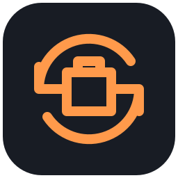

# Brickloop（积环）

在三维里设计积木模型，也可以从一张照片开始，让 AI 搭出初稿，再逐件审阅。

[English](README.md) · **简体中文**

[](../../releases/latest)
[](LICENSE)

[](../../actions/workflows/ci.yml)


<sub>左：圣瓦西里大教堂，摄影 Erik Charlton，CC BY 2.0（裁切）。右：看图搭建用 DeepSeek 据此生成的 1,194 件模型。</sub>

[**下载**](../../releases/latest) · [从源码构建](#从源码构建) · [使用说明](docs/user-guide/README.md) · [参与贡献](CONTRIBUTING.md)

</div>

---

积环是一个 Windows 桌面应用，用来设计积木模型并为实际搭建做准备。在三维工作区里放置零件，零件按真实的连接点吸附；检查碰撞和工厂无法生产的零件；导出搭建说明书、零件清单和 BrickLink Studio 文件。

AI 助手和你使用同一套编辑命令操作同一个模型。它可以从参考照片搭出初稿，也可以按你的描述修改；它做的每一处改动都会在三维审阅里标出来，由你决定保留还是撤销。

## 主要功能

- **看图搭建。** AI 规划模型的组成部分，编写搭建脚本，渲染结果，与照片比对轮廓后再修改，一轮一轮推进。得到的是可以继续编辑的模型，不是一张图。
- **AI 的改动可以审阅。** 新增、删除、改色和移动的零件都会在视口里标出。可以逐项、按组或整轮保留或撤销。
- **自选模型服务。** 17 个服务商预设，包括 DeepSeek、通义千问、Kimi、OpenAI、Anthropic、Gemini 和本机 Ollama，多数只需要填 API Key。Key 用 Windows DPAPI 加密保存，除了发给你选择的服务商，不会离开本机。
- **接入编程智能体。** 内置 MCP 服务，经你确认连接后，Claude Code、Codex 等工具可以操作当前打开的工程。
- **面向生产的检查。** 碰撞、悬空、工厂没有的颜色、工厂做不了的零件与颜色组合，每条结果都关联到具体零件。
- **实际可用的输出。** 搭建说明书 PDF、CSV 或 XLSX 格式的物料清单、OBJ、DAE、GLB、可在 BrickLink Studio 中打开的 `.io` 文件，以及 1080p 的搭建动画 MP4。

## 搭建过程

搭建动画可以按两种顺序播放模型，两种都能导出为视频。

### 按层


<sub>同一个模型，一层一层搭起来（2 倍速）。</sub>

### 按说明书步骤


<sub>同一个模型，每个部件设为一个说明书步骤，按步骤顺序搭建（2 倍速）。说明书 PDF 使用的就是这个顺序。</sub>

## 界面

### 工作区

左侧是零件库和宏，中间是三维视口，右侧是色板、结构、检查和 AI 助手。按住 Alt 拖动旋转视角，滚轮朝光标处缩放。

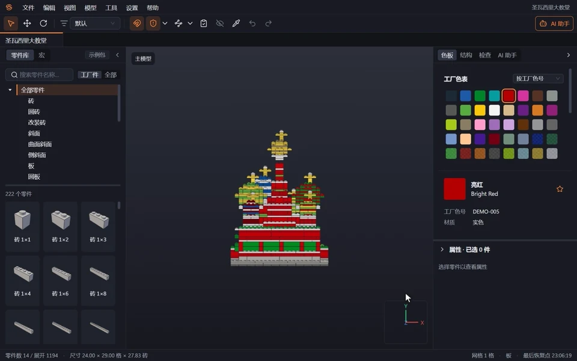

### 搭建动画

选择拼装顺序、零件入场方式和镜头运动，最高 4 倍速预览，然后导出视频。

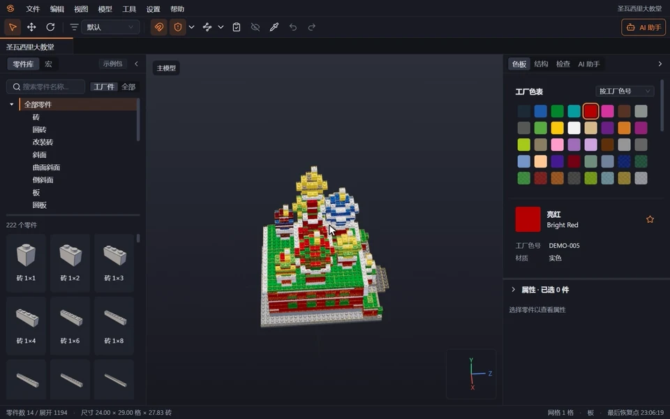

### 接入 AI 服务商

选择账号登录或 API Key，搜索预设，粘贴 Key，在同一个表单里测试连接。

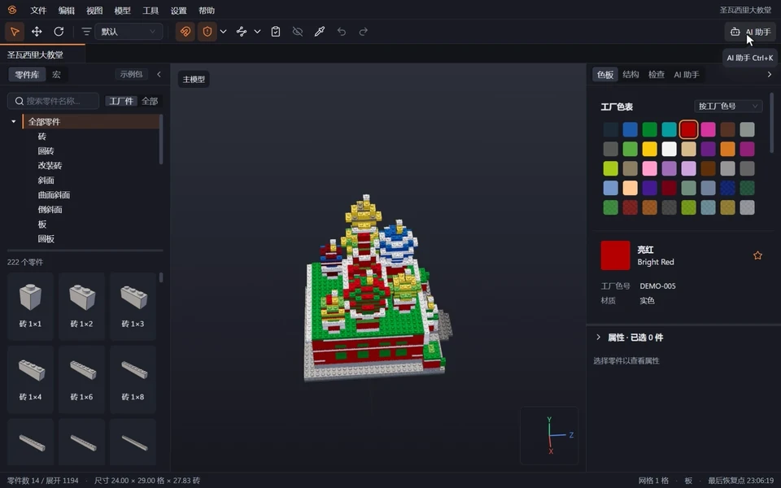

### 更多截图

<table>
  <tr>
    <td width="50%">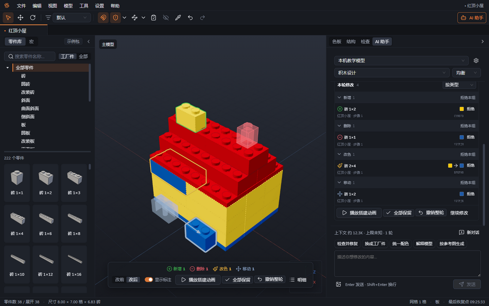<br>三维审阅标出新增、删除、改色和移动的零件，可以撤销单项或整轮。</td>
    <td width="50%">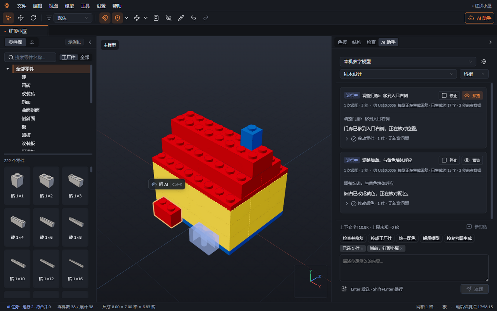<br>多个 AI 任务可以同时运行，期间可以继续编辑。</td>
  </tr>
  <tr>
    <td>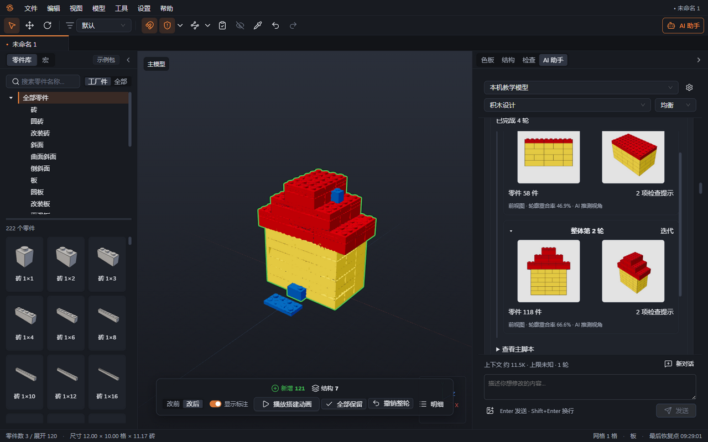<br>看图搭建的每一轮显示零件数，以及轮廓与参考图的重合程度。</td>
    <td>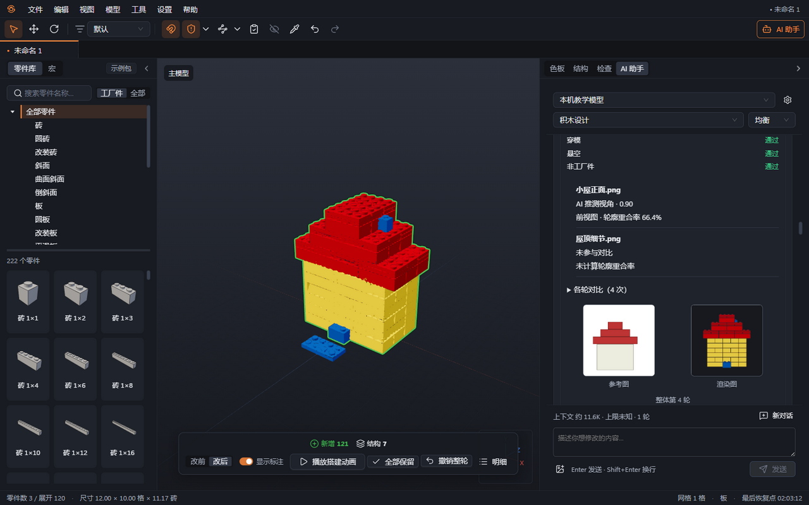<br>任务报告列出检查结果、推测视角和最终重合率，可以导出 <code>.io</code>。</td>
  </tr>
  <tr>
    <td><br>连接点亮起，零件吸附到位。</td>
    <td>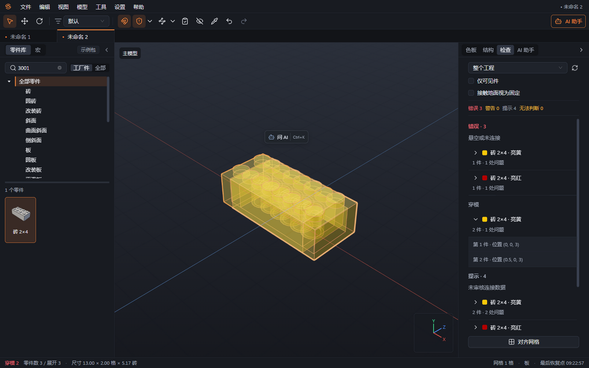<br>检查结果按类型分组，并关联到零件。</td>
  </tr>
  <tr>
    <td><br>修改一次共享子模型，所有实例一起更新。</td>
    <td>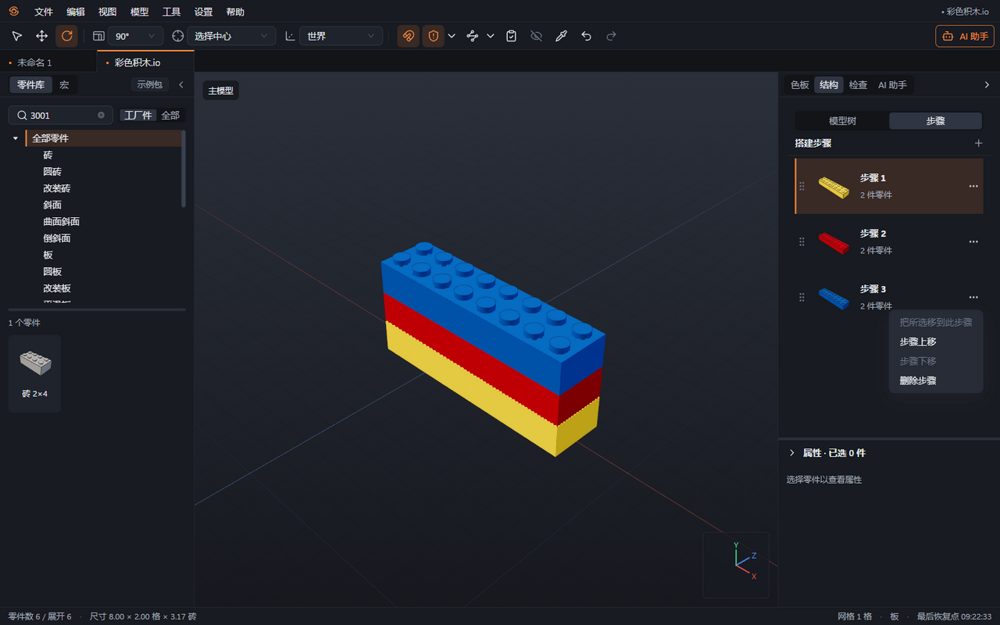<br>搭建步骤可以分配、调整顺序和逐步查看，说明书直接使用这些步骤。</td>
  </tr>
  <tr>
    <td>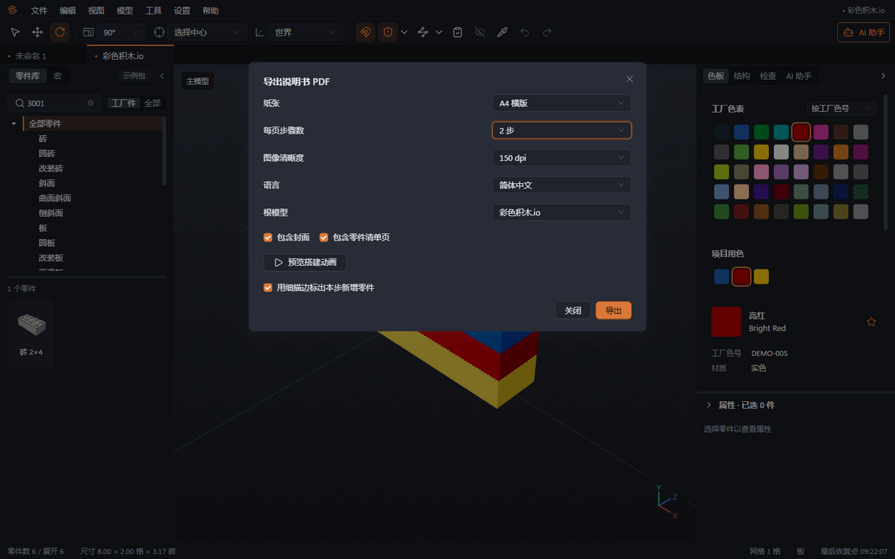<br>说明书 PDF：版面、每页步骤数、零件清单和图片分辨率。</td>
    <td>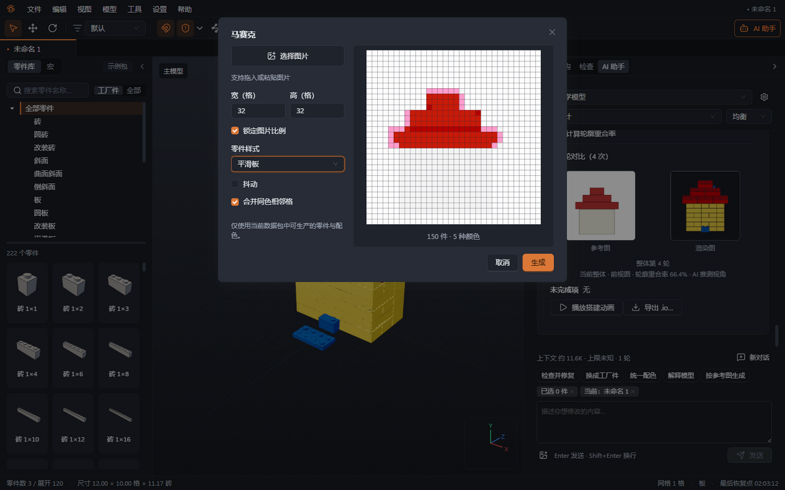<br>马赛克把图片转成平面图案，只使用工厂有的颜色。</td>
  </tr>
</table>

## 安装

1. 从[最新版本](../../releases/latest)下载 `Brickloop-<版本>-win-x64-setup.exe`（约 270 MB）。
2. 用同一版本附带的 `SHA256SUMS.txt` 核对 SHA-256，例如在 PowerShell 里运行 `Get-FileHash -Algorithm SHA256 .\Brickloop-<版本>-win-x64-setup.exe`。
3. 运行安装包。安装包没有代码签名，Windows 可能提示"Windows 已保护你的电脑"。确认文件来源后，选择"更多信息"→"仍要运行"。
4. 首次启动会生成零件缓存，需要 10–20 秒。

使用 AI 功能前，在"设置 → AI"里添加服务商。积环没有自己的账号和服务器，请求直接从你的电脑发到你配置的服务商。

## 从源码构建

需要 Windows x64、Node.js 22.13 或更高版本和 pnpm 10。缓存、临时文件和测试数据都放在仓库内的 `.devdata`。

```powershell
pnpm run setup      # 安装依赖并下载界面字体
pnpm ldraw:fetch    # 把固定版本的 LDraw 零件库下载到 library/ldraw
pnpm dev            # 以开发模式启动
pnpm verify         # 类型检查、lint、格式、语言键、单元测试
pnpm e2e            # Electron 端到端测试（Playwright）
pnpm package        # 构建 Windows 安装包到 dist/
```

请用 `pnpm run setup`，不要用 `pnpm setup`：后者是 pnpm 自带的命令。桌面应用的目录结构、进程安全设置和测试见 [apps/desktop/README.md](apps/desktop/README.md)，`packages/` 下的每个包也有自己的 README。

## 架构

所有编辑都经过同一条命令总线。界面、快捷键、AI 工具和 MCP 工具最终都调用 `dispatch(command)`，所以无论改动从哪里来，撤销、恢复日志和三维审阅的行为都一样。

<picture>
  <source media="(prefers-color-scheme: dark)" srcset="docs/readme/architecture-dark.svg">
  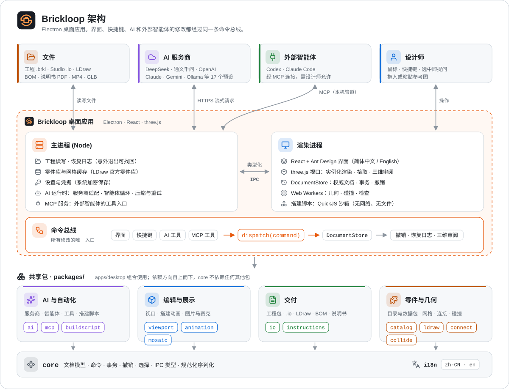
</picture>

使用 Electron、React、three.js 和 TypeScript 构建。包之间的依赖只向下，`core` 不依赖其他包。`mcp` 复用 `ai` 的工具定义。图标来自 [Lucide](https://lucide.dev)（ISC）。

## 现状

- 版本号为 0.x：1.0 之前功能和文件细节仍可能变化。
- 只支持 Windows x64。
- 界面默认简体中文，可以切换到英文。使用说明为中文。
- 随应用提供的工厂零件与颜色清单是演示数据；你自己的清单可以作为 `.brklpack` 数据包导入。
- AI 的结果是初稿。一次看图搭建可能需要 30–60 分钟，模型仍需要设计师修整。

## 参与贡献

欢迎提交问题、建议和 PR，中文或英文都可以。请先阅读 [CONTRIBUTING.md](CONTRIBUTING.md)。安全问题请按 [SECURITY.md](SECURITY.md) 私下报告。所有参与者都应遵守[行为准则](CODE_OF_CONDUCT.md)。

各版本的变化见 [CHANGELOG.md](CHANGELOG.md)。

## 许可

积环以 [MIT 许可证](LICENSE)发布。Copyright © 2026 Vesperis（孤独翼梦）。

零件几何数据来自 [LDraw.org 零件库](https://library.ldraw.org/)，版权归零件作者和贡献者所有，每个文件按其声明采用 CC BY 2.0 和/或 CC BY 4.0 许可。LDraw 由 James Jessiman 创建。其他依赖和字体的许可见 [docs/third-party.md](docs/third-party.md)。

LEGO® is a trademark of the LEGO Group of companies, which does not sponsor, authorize or endorse this project. LEGO® 是乐高集团的商标，乐高集团不赞助、不授权也不认可本项目。BrickLink 和 BrickLink Studio 是其各自所有者的商标。积环与它们均无关联。
