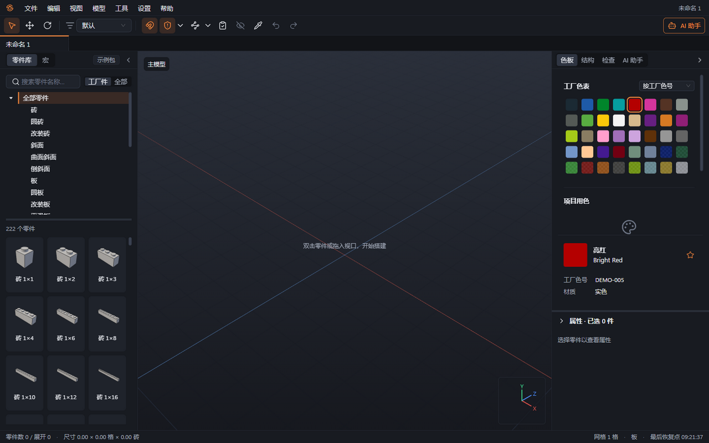
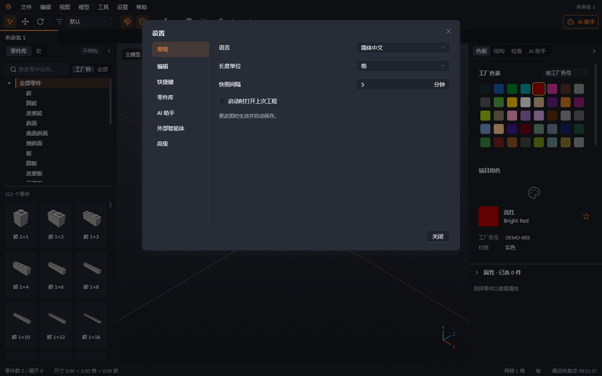
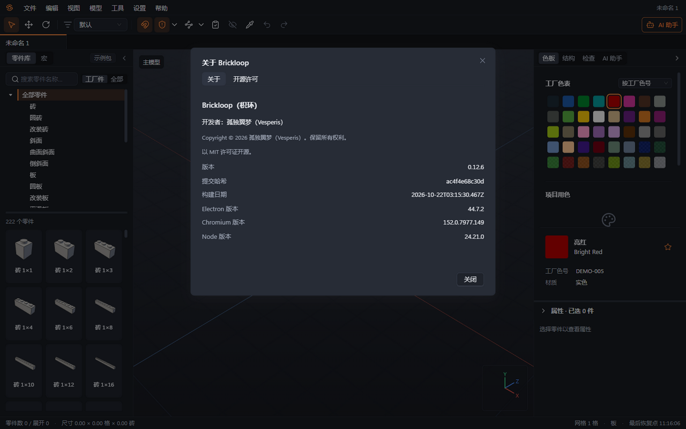

# 01 安装与启动

本章你将学会：安装 Windows 版 Brickloop，完成首次启动，找到常用设置，并打开或新建工程。

当前版本为 **0.12.6**。安装包和校验值在 GitHub 的 [Releases](https://github.com/WangARui666/brickloop/releases) 页面，各版本的变化见 [CHANGELOG](../../CHANGELOG.md)。

## 安装与第一次打开

1. 从 [Releases](https://github.com/WangARui666/brickloop/releases) 页面下载 Windows x64 安装程序，用同一版本附带的 `SHA256SUMS.txt` 核对文件校验值。
2. 双击安装程序，按中文提示选择安装目录并完成安装。程序按当前用户安装，可创建开始菜单和桌面快捷方式。
3. 若 Windows 显示“Windows 已保护你的电脑”，确认来源和校验值后，选择“更多信息 → 仍要运行”。安装包没有代码签名；组织策略不提供此选项时，联系管理员处理。详细说明见[常见问题](16-常见问题.md)。
4. 安装结束后，从开始菜单或桌面启动 Brickloop。安装程序不会自动替你启动应用。
5. 等待左侧零件库加载。完整发行包附带 LDraw 零件库、示例数据包、内置宏及说明书所需的 Noto Sans SC 字体，无需安装 Studio 或另行下载零件库。

LDraw 是软件使用的积木形状资料库；工厂数据包则说明哪些零件和颜色可供当前工厂生产。首次加载可能需要生成零件图片，先等待加载完成，再搜索零件。

## 打开或新建工程

1. 选择“文件 → 新建”或按 Ctrl+N，新建一个空工程。
2. 选择“文件 → 打开”或按 Ctrl+O，打开已有 `.brkl` 工程；也可以从“文件 → 最近打开”选择。
3. 已安装文件关联时，双击 `.brkl` 文件即可在 Brickloop 中打开。首次由 Windows 询问打开方式时，选择 Brickloop。应用已启动时，文件会交给已有窗口；同一文件已打开时只切换到对应标签。双击 `.brklpack` 会进入数据包审阅，确认后才导入。
4. 编辑后按 Ctrl+S，指定工程名称和保存位置。多个工程会出现在独立标签中，各自保存、各自撤销。

从源码打包时会同时生成免安装目录 `dist\win-unpacked`。使用免安装版本时保留整个文件夹结构，运行其中的 `Brickloop.exe`；需要打开工程时使用“文件 → 打开”，也可运行 `Brickloop.exe "工程路径.brkl"`；免安装目录不会注册文件关联。

## 设置一次常用偏好

1. 选择“设置 → 设置”或按 Ctrl+,，在左侧“常规”中选择语言、长度单位、是否启动时打开上次工程，以及自动保存快照间隔。快照用于意外退出后的恢复，不代替 Ctrl+S 保存正式文件。
2. 在“编辑”中设置默认网格步长、旋转步长、碰撞策略、吸附默认值和连续按键是否合并为一次撤销。
3. 在“零件库”中检查零件库路径、启用的数据包和缓存位置。更换工厂资料的流程见[第 3 章](03-零件库与数据包.md)。
4. 在“快捷键”中调整个人键位；“AI 助手”和“外部智能体”用于模型接入；“高级”提供日志、开发者模式与“零件库维护模式”。日常搭建使用默认模式即可。

设置修改即时生效并自动保存，无需点击“应用”。状态栏与属性位置会跟随长度单位；属性区也可临时选择另一单位。“设置 → AI 设置”和“设置 → 数据包管理”保留为快捷入口。

设置、凭据和最近文件位于 `%APPDATA%\Brickloop`；恢复资料位于 `%LOCALAPPDATA%\Brickloop\recovery`，缓存位于 `%LOCALAPPDATA%\Brickloop\cache`。加密凭据所用的密钥在 `%LOCALAPPDATA%\Brickloop\session`，它不是缓存：不要删除，也不要把它当作可清理的内容。0.12.0 及更早版本把它放在 `cache\session`，0.12.1 首次启动时自动移出，已保存的 Key 和登录照常可用；缓存文件夹现在可以整个删除，程序会重新生成。升级时自动迁移旧位置的数据；迁移失败会继续使用旧位置并在下次启动重试，不删除旧数据。

## 查询版本

1. 选择“帮助 → 关于 Brickloop”，查看版本、开发者（孤独翼梦 / Vesperis）、版权声明与构建信息。
2. 打开“开源许可”页，搜索第三方组件、LDraw 署名和 Noto Sans SC 字体的开放字体许可。构建信息包含提交哈希、构建日期以及 Electron、Chromium、Node 版本。反馈问题时附上版本和构建信息。

下一章：[界面介绍](02-界面介绍.md)。
