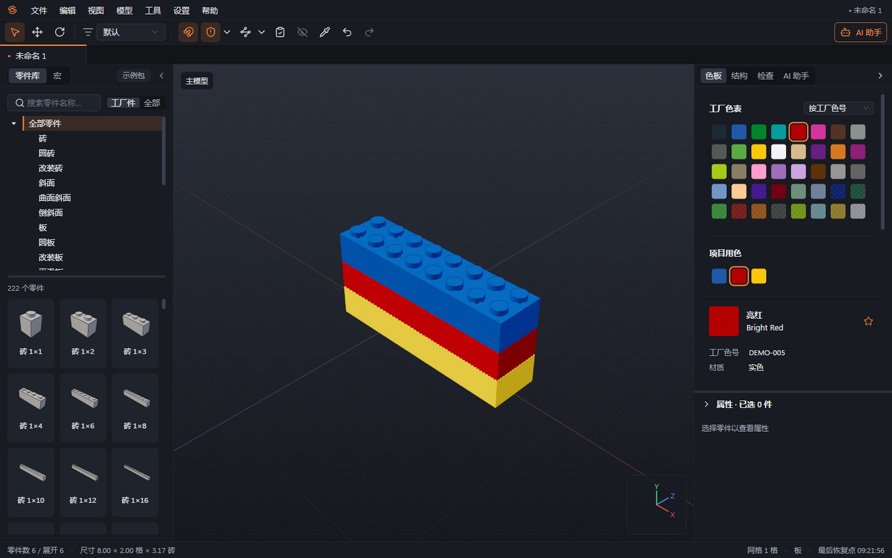
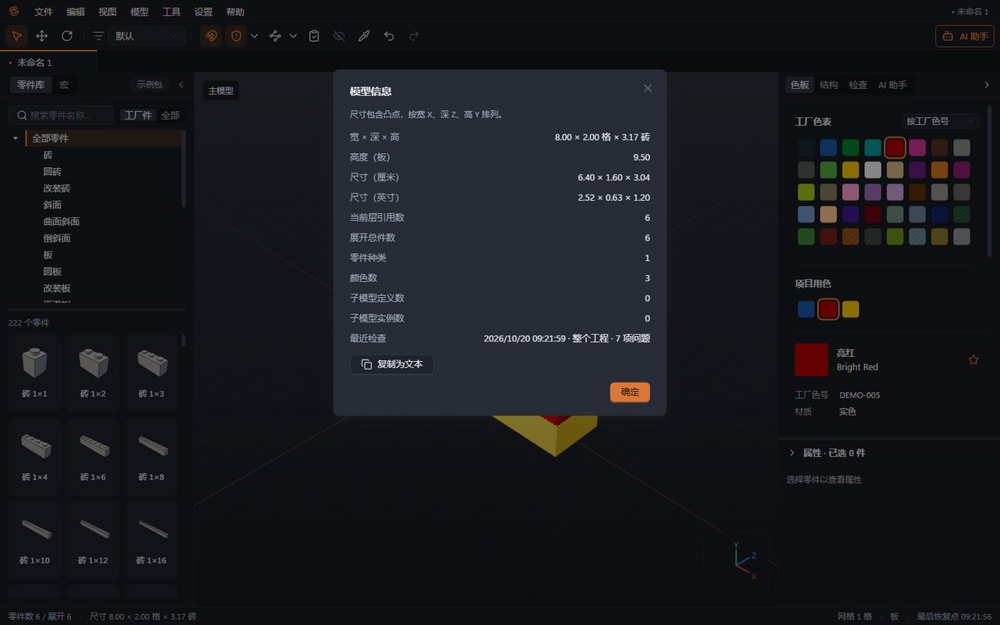

# 02 界面介绍

本章你将学会：找到零件、颜色、模型结构和检查入口，调整视角，并读懂模型的零件数和尺寸。

## 工作区各部分

视口是中央显示三维模型、放置和编辑零件的区域。围绕视口的常用区域如下。

| 区域           | 用途                                                       |
| -------------- | ---------------------------------------------------------- |
| 顶部菜单       | 文件读写、编辑、视图、模型、工具、设置与帮助               |
| 编辑工具栏     | 切换“选择”“移动”“旋转”，控制吸附、碰撞与连接点             |
| 文档标签       | 在多个工程间切换；名称旁的小圆点表示有未保存的修改         |
| 左侧“零件库”   | 分类、搜索、零件缩略图、当前数据包；“宏”标签提供组合与图案 |
| 右侧“色板”     | 工厂色表、项目用色、收藏色                                 |
| 右侧“结构”     | 模型树、编组、子模型和步骤                                 |
| 右侧“AI 助手”  | 对话、修改审阅、看图搭建任务卡                             |
| 右侧底部“属性” | 所选零件资料、位置、旋转；多选时显示数量                   |
| 检查区域       | 按 F7 打开，按问题类型定位零件                             |
| 底部状态栏     | 零件数、尺寸、网格、最后恢复点和正在执行的 AI 操作         |

工具栏会随工具变化：选“选择”时显示选择模式；选“移动”时显示网格步长与参照系；选“旋转”时显示旋转步长、旋转中心与参照系。鼠标停在图标上可查看名称和当前快捷键。

## 看清模型

1. 在视口中按住 Alt 并左键拖动，围绕模型旋转视角；中键或右键拖动平移视图，滚轮缩放。右键单击可打开操作菜单。
2. 按 Ctrl+0“适配全部”，让整个模型回到视野中；选中零件后按 F“适配所选”。打开工程时，程序会恢复上次保存的视角；工程没有保存过视角（例如由其他工具或 AI 生成），或保存的视角看不到模型时，会在零件加载完成后自动显示全部。
3. 从“视图 → 预设视角”选择前、后、左、右、顶、底或等轴测视角。数字小键盘 1、3、7 分别切到前、右、顶视图。
4. 从“视图 → 投影方式”选择“透视”或“正交”。透视有近大远小的效果；正交适合比较对齐和比例。

前、后、左、右、顶、底六个预设使用正交投影；等轴测和自由旋转使用透视。手动旋转视角后会回到透视。查看视角不会移动模型中的零件。需要搬动零件时，使用“移动”工具或编辑快捷键。

## 打开较大工程时

工程先显示可拾取的中性灰包围盒，再分批替换为真实零件形状。加载进度尚未结束时，仍可旋转视口、选择、放置和保存。灰色占位表示形状仍在加载；黄色虚线表示碰撞资料无法判断，含义不同。状态栏的“正在检查…”表示后台检查尚未完成，不能将当时尚未列出问题理解为检查通过。

## 调整面板

1. 拖动左右面板与视口之间的分隔条，改变宽度；使用边缘的折叠按钮增加视口空间。
2. 拖动左侧分类区下边界调整分类与缩略图的比例。
3. 在右侧切换“色板”“结构”“AI 助手”；拖动属性区分隔条调整高度，按需折叠属性区。

## 读懂数量与尺寸

1. 选择“模型 → 模型信息”，查看“当前层引用数”“展开总件数”“零件种类”“颜色数”等信息。
2. 当前层的一个子模型按一个引用计数；展开总件数会把其中每个零件按实际使用次数算入。例如，两套各含 6 件的车轮组件，当前层可显示 2 个引用，展开后为 12 件。
3. 尺寸按“宽 × 深 × 高”排列，包含凸点；可查看厘米、英寸和积木单位。宽深的“格”是凸点间距，1 格为 8 毫米；1 板高为 3.2 毫米，1 砖高为 9.6 毫米。
4. 需要传给同事时，点击“复制为文本”。若提示缺少形状资料，先解决缺件再确认尺寸。

状态栏的零件数和尺寸跟随当前编辑模型；进入子模型或 AI 正在搭建时，会使用当前内容重新计算。模型信息的“最近检查”显示检查时间、范围和问题数量；它记录最近一次结果，修改后应重新检查。

下一章：[零件库与数据包](03-零件库与数据包.md)。
