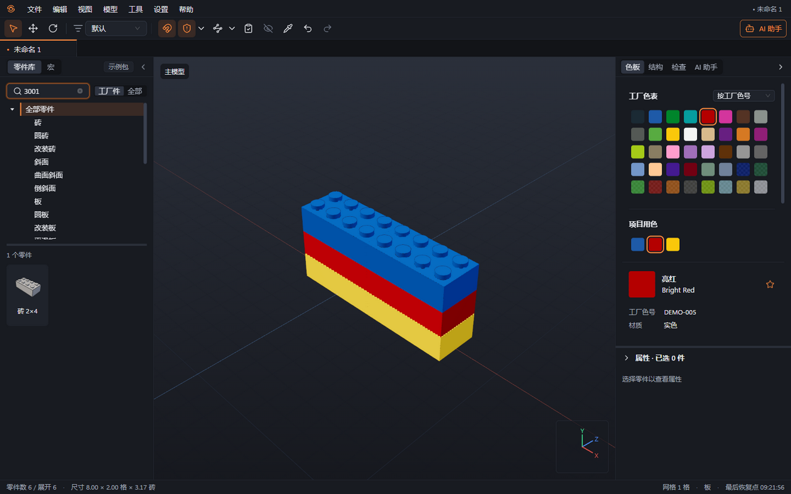
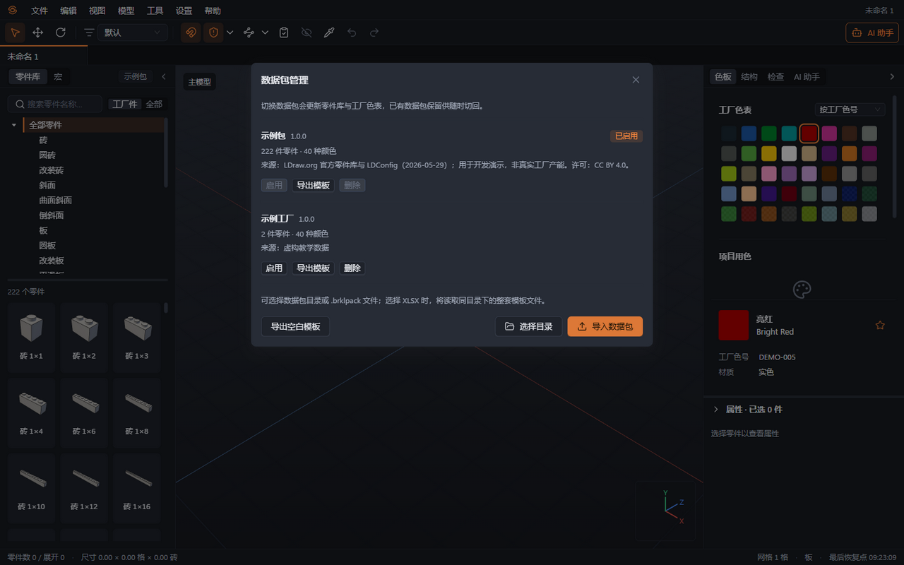
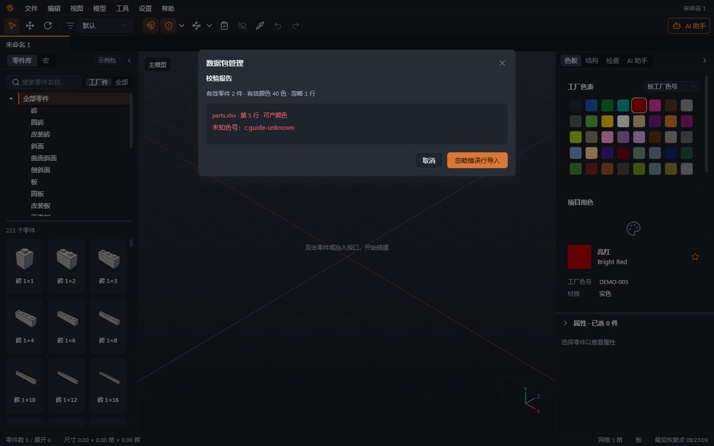
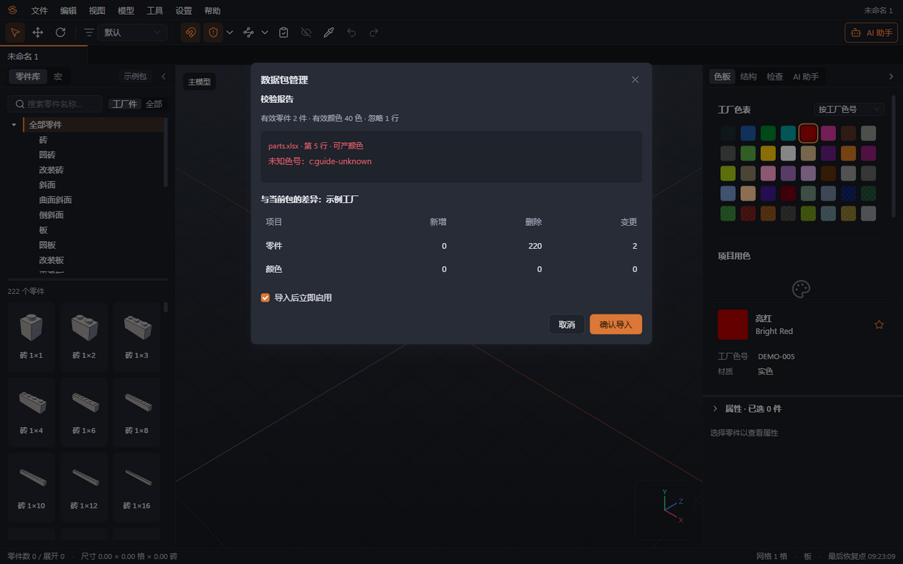

# 03 零件库与数据包

本章你将学会：搜索可用零件和颜色，把模板交给工厂填写，审阅导入结果，并在数据包之间切换和回滚。

## 先认识示例包

数据包是一套可替换的工厂零件表、色表和可生产配色资料。没有真实工厂资料时，可以使用内置“示例包”：含 222 种常用零件、40 种颜色，工厂编号为 `DEMO-P001` 这类占位编号，工厂色号为 `DEMO-001` 这类占位色号。

示例包用于学习和试搭，不能证明真实工厂能生产这些零件或配色。正式交付前应启用经过核实的工厂包并重新检查。

## 搜索零件与选色

1. 在左侧“零件库”输入乐高编号、工厂编号、中文名、英文名或拼音首字母。例如 `3001`、`2x4 砖`、`phb`。尺寸中的 `x`、`×`、`*` 可互换。
2. 选择分类缩小范围。默认“工厂件”只显示当前包可用零件；切到“全部”，即“显示全部 LDraw 零件”，可查找包外零件。
3. 查看零件名称与编号。普通零件缩略图使用中性灰，放置预览按当前颜色显示。
4. 在右侧“色板”选择“工厂色表”“项目用色”或“收藏色”。色块提示和颜色详情先显示中文名，再显示乐高色名与工厂色号；使用星标收藏常用色。
5. 放置后检查该零件与颜色的组合是否可生产。色表中有某个颜色，不代表每种零件都能生产该颜色。

## 导出模板并交给工厂

1. 打开“设置 → 数据包管理”，也可从零件库的“数据包管理”入口打开。
2. 新建工厂资料时点击“导出空白模板”；更新已有资料时，点击对应数据包的“导出模板”。设置的“零件库”页也提供数据包管理入口。
3. 选择保存位置，得到 `.brklpack` 模板。这是 ZIP 格式的资料包；用支持 ZIP 的解压软件打开，或将一份副本扩展名改为 `.zip` 后解压。
4. 把整个模板目录和[工厂填写附录](附录-给工厂的数据包模板说明.md) 发给工厂。目录必须一起保留 `pack.json`、`parts.xlsx` 和 `colors.xlsx`。
5. 先填色表，再填零件的“可产颜色”。空白模板中的示例行要替换或删除；不能只改零件表而遗漏色表。
6. 由资料维护者为这一批资料设置新的包 ID、名称和版本。更新同一工厂资料也使用新包 ID，才能保留旧包供回滚。

## 导入时逐项审阅

1. 在“数据包管理”点击“选择目录”，选择填好的完整模板目录；也可点击“导入数据包”选择 `.brklpack`。选择 XLSX 文件时，程序会读取同目录下整套模板，并非只导入选中的一张表。
2. 阅读“校验报告”：先看有效零件、有效颜色和忽略行数，再按文件名、行号、列名查看原因。模板第 1 行是表头，第 2 行是说明，通常第 3 行开始才是数据。
3. 对重复编号、未知色号、无法匹配的乐高编号等错误，取消导入并请工厂修正。只想试用部分资料时，可选择“忽略错误行导入”，重新查看剩余有效行。缺文件、缺表头、模板版本不支持或内容校验失败不能靠跳行解决。
4. 阅读“与当前包的差异”，核对零件与颜色的新增、删除、变更数量。特别检查删掉的常用零件、改变含义的色号和缩减的可产配色。
5. 选择是否勾选“导入后立即启用”，点击“确认导入”。没有勾选时，资料只进入列表，当前包不变。

## 切换、检查影响与回滚

1. 在数据包列表找到目标包，点击“启用”。同一时间只有一个包生效。
2. 切换或回滚前，如有影响，先阅读“切换数据包的影响”。对话框按已打开工程列出将变为非工厂件、非工厂色及不可供货配色的项目，选择“继续”或“取消”。勾选“导入后立即启用”时也会检查。确认切换后运行 F7 检查。换包不会移动零件或自动换色，但相同模型可能变成“非工厂零件”“非工厂颜色”或“不可生产的配色”。
3. 打开使用另一数据包保存的工程后，先检查其工厂可用性。对未核实的替代方案，先另存工程。
4. 需要回滚时，在列表中对旧包点击“启用”，重新运行检查。回滚恢复的是目录、编号与可用性，切换期间做过的人工改件、AI 改色仍需通过撤销或工程备份恢复。
5. 保留仍用于生产的旧包。示例包和正在使用的包不能删除。

工厂独有色没有通用色名时，颜色身份与工厂色号有关。改色号可能被识别为新颜色；不要用“名字看起来相近”判断两个配色完全相同。

“设置 → 设置 → 零件库”可选择含 `parts` 和 `LDConfig.ldr` 的零件库文件夹，查看缓存路径与占用大小，并清理可重新生成的几何、缩略图和目录缓存。清理后第一次加载可能较慢；工程、凭据和恢复资料会保留。

下一章：[搭建与编辑](04-搭建与编辑.md)。
