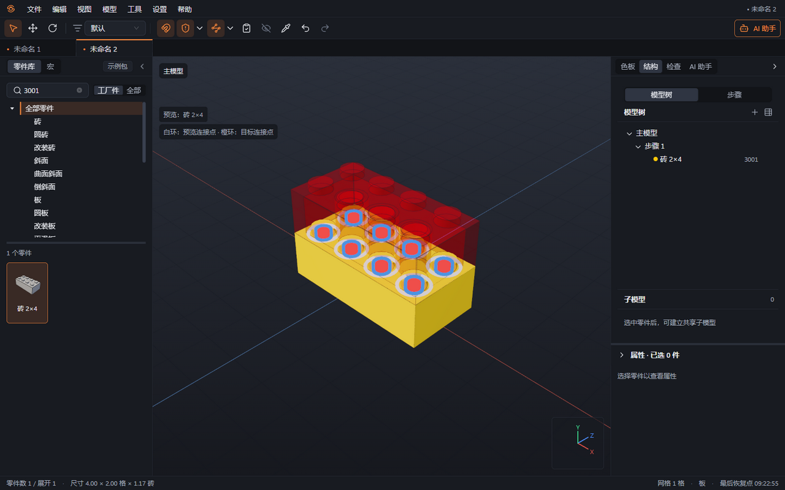
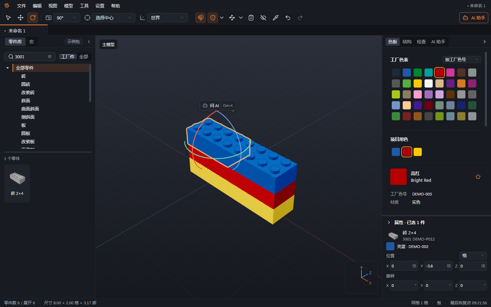

# 04 搭建与编辑

本章你将学会：放置和选择零件，用网格、手柄与数值调整位置和角度，换色、复制、隐藏，并撤销不满意的操作。

## 放置第一件

1. 在零件库搜索零件，双击缩略图或将其拖入视口，进入放置预览。
2. 在“色板”选择颜色，将鼠标移到地面或已有零件附近。开启“吸附”时，预览优先寻找兼容连接点。
3. 用方向键旋转预览；按住 Shift 再按方向键，通常按 45° 旋转。
4. 单击放置。按住 Shift 单击可连续放置相同零件；按 Esc 取消余下预览。
5. 在右侧“结构”中核对新零件及其步骤。新零件进入当前步骤。

## 选择需要修改的内容

1. 单击零件替换选择，Ctrl+单击添加或移除一件。最后点选的零件称为主选件，可作为局部移动和旋转的参照。
2. 在空白处拖框：从左向右只选完全落在框内的零件，从右向左选与框相交的零件；Shift+框选追加选择。
3. 在“选择模式”切换“同色”“同类型”“同色同类型”或“已连接”，再点目标零件。“已连接”依据连接数据选择，外观相贴不一定被判为连接。
4. 按 Ctrl+A 全选当前编辑范围内的可见内容；“编辑 → 反选”反转选择。隐藏件不在普通全选范围内。

在子模型或编组外，点击内部零件会选择整个部件或组。要改内部单件，先双击进入，见[第 5 章](05-子模型与编组.md)。

## 移动与对齐

1. 选中零件，切换“移动”。拖动轴箭头沿一条轴移动，拖动平面手柄在一个平面内移动。
2. 设置“水平网格步长”为 1 格、½ 格或 ¼ 格；数字行 1、2、3 分别切换这三个档位。竖直步长可选“板”“砖”“细”，分别为 3.2 毫米、9.6 毫米和 0.4 毫米。
3. 使用 W/A/S/D 沿当前视角最近的水平轴步进；Q 向上，E 向下。旋转视角后，水平移动方向会随之调整。
4. 需要精确位置时，在“属性 → 位置”输入数值，并选择“位置单位”：LDU、格、板高、毫米或厘米。LDU 是 LDraw 长度单位，1 LDU 为 0.4 毫米。
5. 需要自由摆放时选择“自由”；回到规则网格时，使用“模型 → 对齐网格”或 Ctrl+Shift+A。对齐会改变位置，完成后重新检查连接。

属性中的位置按世界坐标填写，X、Z 是水平轴，Y 的负方向向上。键盘 Q/E 已按向上、向下处理，不需要自行换算符号。

## 旋转与换色

1. 切换“旋转”，选择旋转步长，再拖动 X/Y/Z 旋转环。拖动步长可选 90°、45°、22.5°、15°、5°、1°或“自由”。
2. 在“旋转中心”选择“选择中心”“主选件原点”或“连接点”。“参照系”可选“世界”或“主选件局部”；局部参照沿主选件自身方向操作。
3. 普通方向键采用当前旋转步长（默认 90°，自由模式下为 5°），Shift+方向键为 45°；左右键绕竖直轴，上下键绕与视角相关的水平轴。以连接点为中心调整关节时，还会受到关节步长与限位约束。
4. 在“属性 → 旋转”输入精确角度，或在色板中点击颜色给所选内容换色。
5. 按 I 开启“吸管”，点击已有零件吸取颜色。更换工厂色后，用 F7 检查每种零件的配色是否可生产。

## 边线显示

在“设置 → 编辑 → 边线”选择“自动”或“始终显示”。自动模式会在较大场景中省略远处小于几个像素的零件边线，靠近观察时恢复；需要始终观察轮廓时选择“始终显示”。此选项不删减零件，也不关闭检查。

## 复制、隐藏与撤销

1. Ctrl+C 复制，Ctrl+X 剪切，Ctrl+V 粘贴；按 C“复制并附在鼠标上”可直接进入副本放置预览，单击确定位置，Esc 取消预览。
2. 按 Delete 删除所选内容。按 H“隐藏所选”，Shift+H“只显示所选”，Alt+H“显示全部”。隐藏用于整理视野，零件仍留在工程中。
3. 按 Ctrl+Z 撤销，Ctrl+Shift+Z 或 Ctrl+Y 重做。一次拖动是一个撤销点；同一选择连续移动或旋转，间隔不超过约 1 秒时可合并为一个撤销点，可在“设置 → 编辑”中调整。
4. 隐藏、选择和相机变化不进入编辑撤销历史。撤销后再做新修改，会清除原来的重做分支。

下一章：[子模型与编组](05-子模型与编组.md)。
