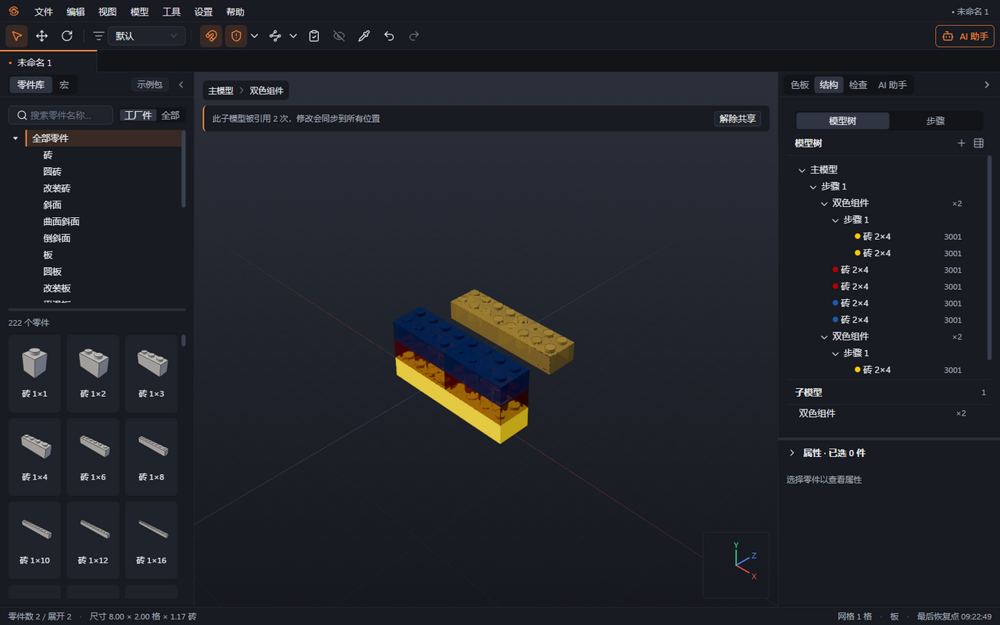
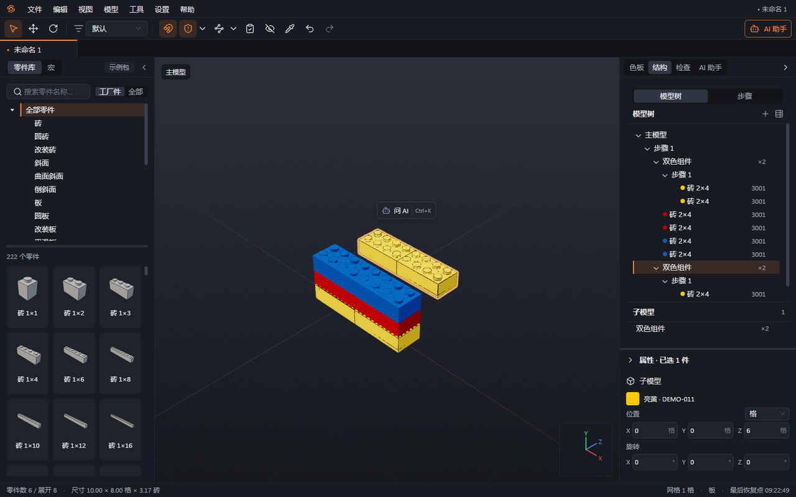

# 05 子模型与编组

本章你将学会：用编组方便整体选择，用子模型复用结构，并判断什么时候需要解除共享。

编组是给一批零件建立的选择集合，便于一起移动；子模型是可重复使用的部件定义，多次放置可以共享同一份内容。实例是零件或子模型在工程中的一次放置。

| 需求                               | 适合使用   | 修改后的影响                                   |
| ---------------------------------- | ---------- | ---------------------------------------------- |
| 将桌面与桌腿暂时作为整体选择       | 编组       | 修改这一组，不产生其他位置的联动               |
| 四个相同车轮，改一次轮毂就全部更新 | 共享子模型 | 内部修改同步到引用它的所有位置                 |
| 其中一个车轮要单独改造             | 解除共享   | 该实例变为独立定义，再修改不影响原来的车轮     |
| 在不同工程反复调用同一家具拼法     | 保存为宏   | 作为资源插入，见[第 11 章](11-宏与搭建步骤.md) |

## 建立和编辑编组

1. 选择同一编辑范围中的零件，执行“模型 → 建组”或 Ctrl+G，输入便于辨认的名称。
2. 在组外点击其中一件，会选中整组；双击进入组内，单独选择零件修改。
3. 用 Esc 或视口上方的路径返回上一级。嵌套组可逐层进入。
4. 需要改名时按 F2；需要拆开选择关系时执行“模型 → 解散组”或 Ctrl+Shift+G，零件仍留在原位置。

编组不能跨越两个不同子模型。若选中的零件位于不同层级，先回到同一层级，或分别组织。

## 创建和重复使用子模型

1. 选中构成一个部件的零件，执行“模型 → 建子模型”或 Ctrl+Alt+G，填写名称，例如“车轮”。原处会保留这个新子模型的一个实例。
2. 在右侧“结构”查看子模型，双击进入编辑。其他内容会变暗、降低饱和度，帮助你辨认当前编辑范围。
3. 选中子模型，使用“模型 → 再放一个”，或从结构面板拖出已有子模型，放置共享实例。
4. 编辑内部零件时，留意“此子模型被引用 N 次，修改会同步到所有位置”的提示。各实例摆放的位置和旋转保持各自独立。
5. 按 Esc 返回上一级，检查所有引用位置是否符合预期。

## 单独修改一个副本

1. 返回父级，选中需要单独改造的子模型实例。
2. 执行“模型 → 解除共享”，再进入修改；内部嵌套的用户子模型也会复制，使该副本独立。
3. 若要同时保留原件并增加一个独立副本，使用结构操作中的“复制为独立副本”。
4. 若不再需要部件结构，执行“模型 → 展开子模型”。内部内容会回到父级并保持世界位置，之后不再作为这一子模型实例联动。

## 跨工程复制与清理

1. 选择要复制的部件，Ctrl+C；切换目标标签，Ctrl+V 并放置。
2. 同一工程内复制的子模型继续共享原定义。跨工程复制会在目标工程建立新定义；同一批复制内容中原本共享的多个实例，在目标工程中仍共享。
3. 删除某子模型最后一个实例后，定义可能仍出现在“未使用”中，方便再次调用。
4. 保存时如果出现“保留未使用的子模型？”，选择“保留并保存”继续保留资源，或“清理并保存”移除未使用定义。未使用定义不计入实际用料。

软件会拒绝把子模型放进自身或其后代，避免形成无法展开的循环结构。

下一章：[连接与碰撞](06-连接与碰撞.md)。
