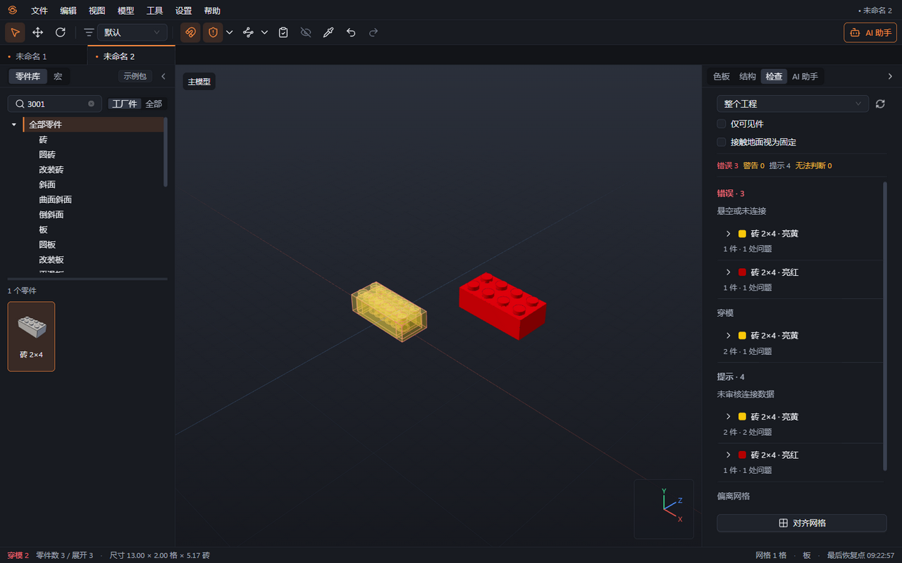

# 06 连接与碰撞

本章你将学会：用吸附帮助零件对齐，辨认连接点，并分别判断零件是否连接、是否发生穿模。

连接点记录零件上可以拼接的位置和类型，例如凸点、底部凹位、十字轴与十字孔。碰撞检测检查零件实体是否相互穿入；已经吸附连接的零件，仍可能在其他部位发生碰撞。

## 用吸附放置零件

1. 在工具栏开启“吸附”，将待放置零件移近目标零件的连接位置。
2. 观察白环和橙环：白环是预览零件的连接点，橙环是目标连接点。预览会自动对齐兼容的位置与方向。
3. 没有合适连接点时，调整视角或旋转零件再尝试。没有吸附候选时，放置会使用网格或支撑表面的位置。
4. 需要临时避开吸附时，在放置或拖动过程中按住 Alt；松开恢复。杆、轴等线性连接在允许范围内可滑动，按 Shift 连续滑动。
5. 单击或松开手柄完成放置，再运行检查核对实体与连接状态。

Alt+左键拖动空白处用于旋转视角；放置预览中的 Alt 用于临时关闭吸附，两者取决于当前操作。

## 查看连接点

1. 开启工具栏“连接点”，在“连接点显示范围”中选择“所选零件”或“全部可见零件”。
2. 移动鼠标查看类型、所属零件及“已连接到”或“未连接”。已连接的连接点会变暗。
3. 结合颜色与形状辨认：红色常表示凸点或球头，蓝色常表示凹位、底管或球窝，黄色常表示孔或夹子。相同颜色也可能有不同类型，应以文字提示为准。
4. 调整关节时，在“旋转中心”选“连接点”，点选需要的连接位置，再操作旋转手柄或方向键。球铰、齿轮铰链等仍受其尺寸、配对与角度限制约束。

植物细杆、轮轴和专用配对不能仅凭外观相似混接。对没有连接数据的特殊件，手动摆放后请维护者核对。

## 理解碰撞的三种结果

| 结果     | 含义                                             | 建议处理                         |
| -------- | ------------------------------------------------ | -------------------------------- |
| 无穿模   | 本次检测没有发现实体相交                         | 继续检查连接与工厂可用性         |
| 发生穿模 | 零件实体发生冲突，预览或零件会以红色、半透明提示 | 调整位置、角度或替换零件         |
| 无法判断 | 缺少检测资料、资料过于粗略或计算尚未完成         | 查看检查明细，补齐资料或重新检查 |

碰撞代理是用于快速检测的简化形状。它缺失或不够准确时，“无法判断”不能当成“无穿模”。软件检查也不能代替实物试搭与结构强度确认。

1. 开启“碰撞检测”，在“碰撞策略”中选择“仅提示”或“阻止放置”。默认“仅提示”允许保留位置并显示问题。
2. 使用“阻止放置”时，确定发生穿模的姿态会被阻止；不要据此认定“无法判断”的位置已经安全。
3. 临时摆造型时可关闭碰撞检测。关闭后允许穿模，交付前应重新开启并检查整个工程。

## 需要维护连接资料时

1. 资料维护者在“设置 → 高级”开启“零件库维护模式”。
2. 在零件库右键选择“编辑连接点”，查看现有连接点与碰撞代理。
3. 使用“从图元推断”时先审阅差异，再决定“采用推断结果”或“保留当前”。选择“参考零件”进行“试配”。
4. 核对方向、尺寸和限位后保存为“草稿”或“已审核”。“推断”表示自动生成，并不等于人工确认。

下一章：[检查](07-检查.md)。
