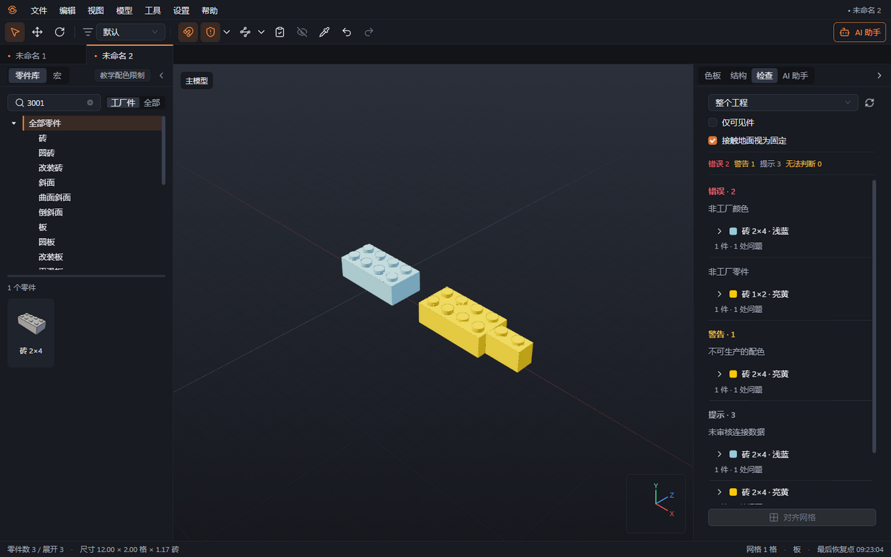

# 07 检查

本章你将学会：选择检查范围，定位穿模与可用性问题，并在交付前完成一次完整复查。

## 运行与定位

1. 按 F7，或选择“工具 → 运行检查”，打开“检查”区域。
2. 设置“检查范围”为“整个工程”“当前子模型”或“所选零件”。检查一小段搭法时可缩小范围；交付前选择整个工程。
3. 按需勾选“仅可见件”。最终检查建议取消该选项，避免漏掉隐藏零件。
4. 按需勾选“接触地面视为固定”。这只改变悬空判定，不会增加真实连接或底板。
5. 点击“重新检查”。结果按“错误”“警告”“提示”“无法判断”分组，展开零件与颜色分组可查看具体位置。
6. 点击问题或某一件的位置，视口会定位到相关零件；必要时进入对应子模型并显示原先隐藏的相关内容。

检查在后台进行，状态栏显示“正在检查…”。继续编辑会更新待检查内容，完整结果就绪后才用于判断。AI 校验和导出前会等待所需检查完成；碰撞预算不足仍明确列为“无法判断”，不会当成无碰撞。

## 各类问题是什么意思

| 问题           | 含义                                     | 常用处理方法                               |
| -------------- | ---------------------------------------- | ------------------------------------------ |
| 穿模           | 两件实体相互穿入                         | 旋转视角，调整位置与角度，检查是否选错零件 |
| 碰撞无法判断   | 碰撞资料缺失、近似或计算未完成           | 重查；持续出现时把零件编号交给维护者       |
| 悬空或未连接   | 未与主体形成可识别连接                   | 检查吸附、连接方向及连接数据，补充支撑     |
| 非工厂零件     | 当前包没有该零件，或已标记停产           | 换成当前工厂件，或向工厂核实数据           |
| 非工厂颜色     | 当前包没有该颜色                         | 换成工厂色表中的颜色                       |
| 不可生产的配色 | 零件与颜色各自存在，但工厂不提供这个组合 | 查看可产配色，换色或换件                   |
| 重叠重复件     | 相同零件、颜色和位置重复出现             | 确认多余实例后删除，复查清单数量           |
| 缺少几何       | 找不到零件形状文件或依赖                 | 补齐对应资料；保留实例以便修复             |
| 未审核连接数据 | 使用推断或尚未审核的连接资料             | 交维护者审核，特殊拼法做实物确认           |
| 偏离网格       | 位置不符合当前网格                       | 先判断是否有意错位，再决定是否对齐         |

“对齐网格”会处理检查结果中的偏离网格项。需要保留铰链、斜拼等位置时，先缩小检查范围，避免把有意设置的姿态一并调整。

## 完成交付前复查

1. 启用准备交付的真实工厂数据包，确认使用的版本。
2. 开启碰撞检测，检查“整个工程”，取消“仅可见件”。
3. 优先处理缺少几何、穿模和悬空，再处理工厂件、工厂色与配色限制。未知结果单独核实。
4. 如需 AI 帮忙，可打开“AI 助手”选择“检查并修复”或“换成工厂件”，完成后审阅修改并再次运行检查。
5. 保存 `.brkl`，再生成交付清单和交换文件。任何改件、换色、换包之后，都要重新检查。

“当前范围未发现问题”只说明这次检查的范围与条件没有发现问题。它不表示已通过工厂打样、强度验证或所有角度的外观审阅。

下一章：[保存恢复与导入导出](08-保存恢复与导入导出.md)。
