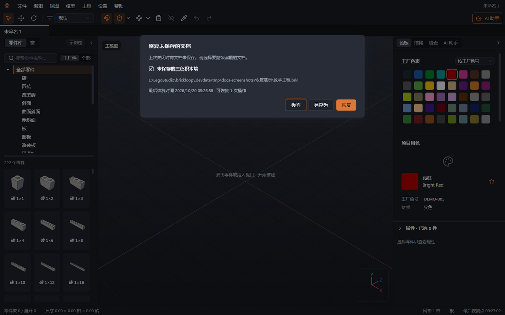
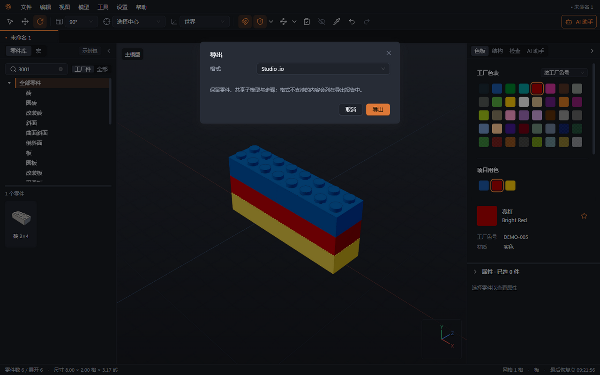
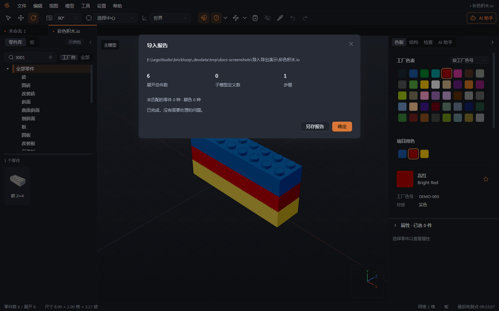

# 08 保存恢复与导入导出

本章你将学会：保存完整工程，恢复意外退出前的工作，把模型交给 Studio 继续编辑，并阅读导入导出报告。

## 保存完整工程

1. 按 Ctrl+S 或选择“文件 → 保存”。首次保存时选择文件名和目录，格式为 `.brkl`。
2. 需要保留旧方案时，选择“文件 → 另存为”或 Ctrl+Shift+S，使用新的名称。
3. 保存后确认文档标签旁的修改圆点消失。关闭有修改的文档时，在“保存更改？”中选择“保存”“不保存”或“取消”。
4. 如提示“没有写入权限”“磁盘空间不足”或“文件被占用”，解决原因后重新保存，或另存到可写位置。不要把未完成的保存当作成功。

`.brkl` 保留零件、颜色、步骤、编组、共享子模型、工作区状态、工程资源和按设置保存的 AI 对话。导出交换文件不能代替保存工程。撤销历史不跨重启保存；再次打开文件后不能撤销上一次运行中的编辑。

## 意外退出后恢复

1. 重新启动 Brickloop，查看“恢复未保存的文档”对话框。
2. 按文档名、原路径、“最后恢复时间”和“可恢复 N 次操作”辨认要恢复的版本。尚未正式保存的工程会显示“尚未保存到文件”。
3. 点击“恢复”继续编辑；希望先留一份独立文件时点击“另存为”；确认不要这份恢复资料时才点击“丢弃”。
4. 恢复后核对零件与参考图，保存为 `.brkl`。恢复文档视为未保存，撤销历史从本次继续编辑开始。
5. 若报告日志或资源损坏，软件会停在最后一个完整可用的恢复点。另存现有内容并保留报告，向维护者反馈。

状态栏“最后恢复点”是已经写入恢复资料的时间。正常磁盘响应下，最近约 1 秒的操作可能尚未持久化；出现“恢复点写入失败，请保存工程以保留修改”时，应立即保存。恢复快照不是长期备份，正常关闭并选择“不保存”会清理该文档的恢复资料。

## 导出给 Studio 继续编辑

1. 先保存 `.brkl`，再运行检查，处理缺少形状资料和需要替换的工厂配色。
2. 选择“文件 → 导出 → Studio .io”。界面中的格式名称是“Studio .io”。
3. 在导出对话框确认格式，点击“导出”，选择 `.io` 文件的保存位置。
4. 阅读“导出报告”。出现颜色降级、编组降级、缺少自制件几何等提示时，点击“另存报告”保留说明。
5. 在 BrickLink Studio 中打开导出的 `.io`，核对件数、颜色、位置、子模型和步骤，做一次编辑并保存。给同事同时提供报告，便于识别格式差异。

| 信息                          | Studio 中的结果                                                                   |
| ----------------------------- | --------------------------------------------------------------------------------- |
| 零件、位置和旋转              | 作为可编辑的积木实例保留；需要相应零件几何                                        |
| 颜色                          | 有对应 LDraw 色号时保留；没有对应色号的工厂色会换成最接近的可导出颜色，并列入报告 |
| 子模型与共享关系              | 保留子模型结构与重复引用，可继续编辑                                              |
| 搭建步骤                      | 保留步骤顺序与零件归属；不等于保留说明书页面排版                                  |
| 编组                          | 降级为注释，Studio 中不保留 Brickloop 的编组操作                                  |
| 隐藏状态                      | 可表达的状态保留；同一共享子模型在不同位置隐藏不同内容时可能降级为可见，并报告    |
| 工厂自制件                    | 提供完整 `.dat` 几何及依赖时随文件携带；缺少几何会报告错误                        |
| 工厂数据包、AI 记录等专有信息 | 不作为完整 Brickloop 工程信息写入 `.io`，继续保存在 `.brkl` 中                    |
| 说明书排版                    | 不输出 Studio 专用说明书排版；PDF 说明书单独导出                                  |

## 导入 Studio 文件并看报告

1. 选择“文件 → 导入”或 Ctrl+I，选择 `.io` 文件。也可从“文件 → 打开”选取支持的模型文件。
2. 在“导入报告”先核对展开件数、子模型数和步骤数，再看未匹配的零件与颜色数量。
3. 查看每条警告和“未导入或未保留的内容”。未匹配零件可能仍能从 LDraw 库显示，但不一定是工厂件；缺少几何则需要补文件。
4. Studio 的专有连接／碰撞数据、说明书排版和柔性参数不会直接导入。参考图可成为工程资源，其原位置配置作为扩展资料保留，不代表原摆放效果已重现。
5. 点击“另存报告”，运行 F7 检查，再将导入结果另存为 `.brkl`。原来的 Studio 文件保留作对照。

旧版加密 `.io` 会显示“不支持的加密格式”。可在能打开它的 Studio 中另存一个可读取版本，或导出 LDraw `.mpd` 再尝试导入；保留原件。

## LDraw 文件交换

1. 导入 `.ldr` 或 `.mpd` 时，使用相同“文件 → 导入”入口。
2. 导出时选择“文件 → 导出 → LDraw .ldr”或“文件 → 导出 → LDraw .mpd”。需要携带多个子模型时，通常选择 `.mpd`。
3. 这些格式可保留零件引用和步骤，但不能完整保存工厂资料、AI 记录与全部工作区状态；仍保留 `.brkl` 作为工作文件。

下一章：[清单与三维导出](09-清单与三维导出.md)。
