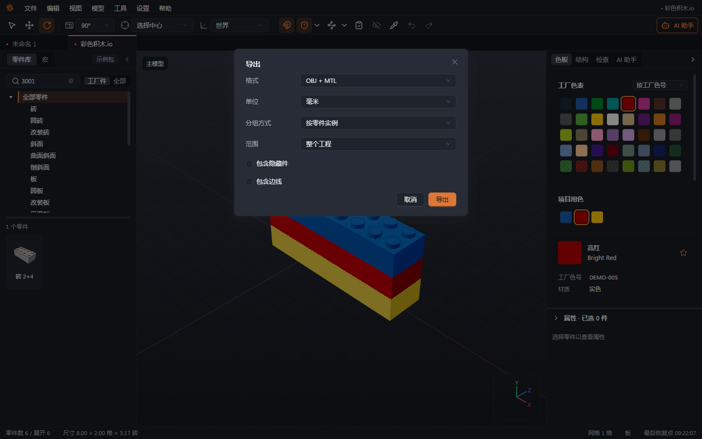
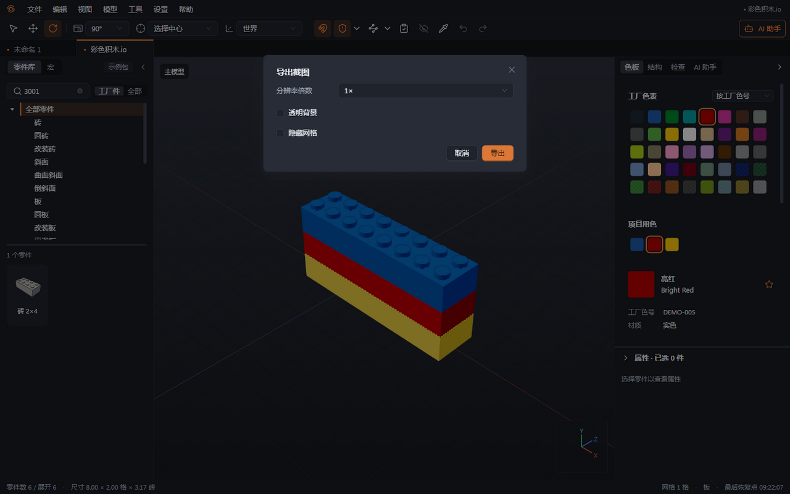

# 09 清单与三维导出

本章你将学会：生成给工厂的零件清单，按用途选择三维格式，并导出用于沟通的模型截图。

## 导出零件清单

BOM 是零件用量清单，按“零件种类＋颜色”汇总数量。共享子模型会按实际放置次数展开，例如每套车轮用 6 件、共放 4 套，清单就计入 24 件。

1. 启用准备交付的工厂数据包，完成[第 7 章](07-检查.md)的检查。
2. 选择“文件 → 导出 → BOM（Excel）”，得到带零件图片的 `.xlsx`；需要纯表格数据时选择“BOM（CSV）”。
3. 在“范围”中选择“整个工程”“当前子模型”或“所选内容”。给工厂整套用料时选择整个工程。
4. 核对“包含隐藏件”。BOM 默认包含隐藏件，因为隐藏通常只是为了方便编辑；按需要明确修改。
5. 点击“导出”，等待零件图片生成和文件写入，再查看汇总件数、种类与颜色数。
6. 打开表格检查“工厂件”“工厂可产”等列。非工厂件、不可产配色和无法映射的项目会标色，应核实后再用于生产。

表格包含乐高编号、工厂编号、零件名称、颜色、工厂色号、颜色中文名、数量、工厂件、工厂可产和分类；Excel 版另含图片，冻结表头并附汇总行。CSV 使用带编码标记的 UTF-8，Excel 可直接识别中文。未知零件或颜色不会被静默丢掉，但缺图、未映射等提示需要处理。

## 为效果图和展示选择格式

| 格式           | 适合用途                         | 交接时注意                                          |
| -------------- | -------------------------------- | --------------------------------------------------- |
| OBJ + MTL      | 导入常见三维软件制作效果图       | 同时发送 `.obj` 与同名配套 `.mtl`，保留二者相对位置 |
| DAE（COLLADA） | 需要场景层级与共享部件的三维交换 | 在接收软件中核对材质和尺寸                          |
| GLB（glTF）    | 单文件查看、网页或三维展示       | 几何与材质打包在一个文件中                          |
| Studio .io     | 继续按积木方式编辑               | 见[第 8 章](08-保存恢复与导入导出.md)               |

OBJ、DAE、GLB 输出的是三维形状与材质，不能代替 `.brkl` 的完整编辑资料。输出形状缺失的零件可能不出现在效果图中，即使数量统计仍包含它们，务必阅读导出报告。

## 导出三维模型

1. 选择“文件 → 导出 → OBJ + MTL”“DAE（COLLADA）”或“GLB（glTF）”。
2. 选择“单位”，默认毫米，也可选厘米或 LDU。1 LDU 为 0.4 毫米。
3. 设置“范围”与“包含隐藏件”。三维导出默认不包含隐藏件，与 BOM 的默认值不同。
4. 导出 OBJ 时选择“按零件实例”或“按颜色合并”。前者便于单独调整某件，后者便于统一处理同色材质。
5. 按需勾选“包含边线”。边线会转换成细网格并增加文件大小；依赖视角的条件边线不能全部固化，省略内容会列入报告。
6. 点击“导出”，在接收软件中核对朝向、透明色和尺寸。例如 2×4 砖的长边应为 32 毫米。

## 导出截图

1. 调整视角和投影方式，隐藏不需要的辅助内容。
2. 选择“视图 → 导出截图”，输出 PNG。
3. 选择“分辨率倍数”1×、2×或 4×；需要叠到其他背景上时勾选“透明背景”，需要干净画面时勾选“隐藏网格”。
4. 导出后查看图像边缘、透明背景和主体是否完整。截图只记录当前视图，不能继续编辑其中的零件。

下一章：[说明书](10-说明书.md)。
