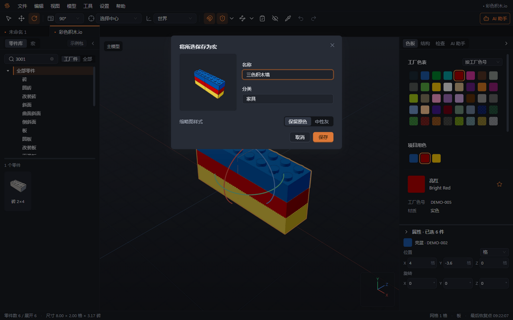
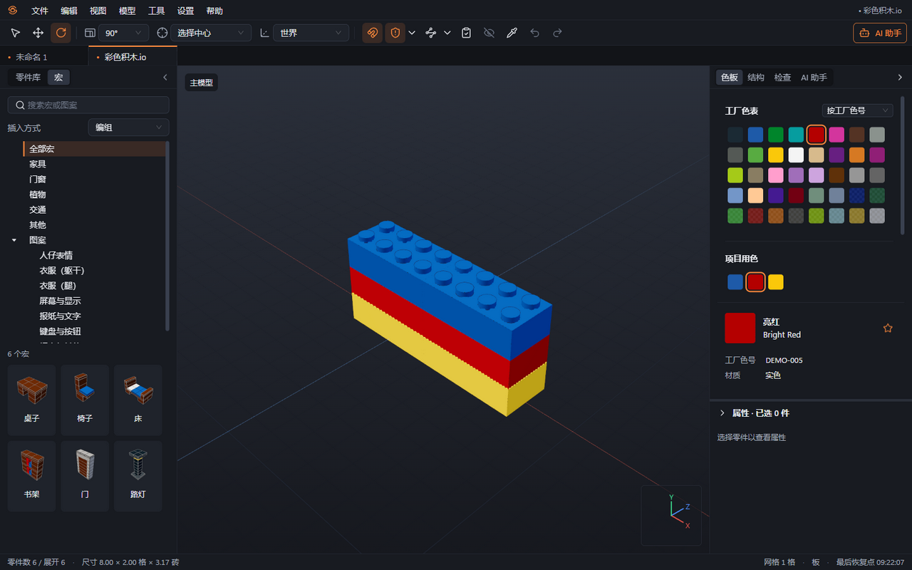
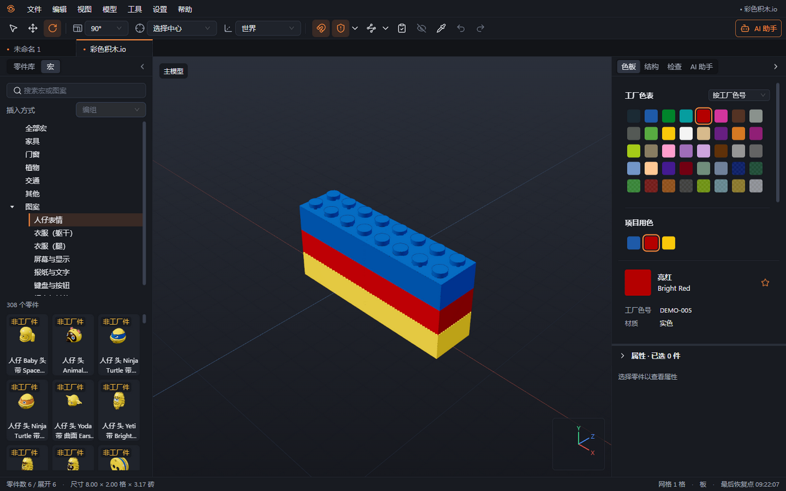
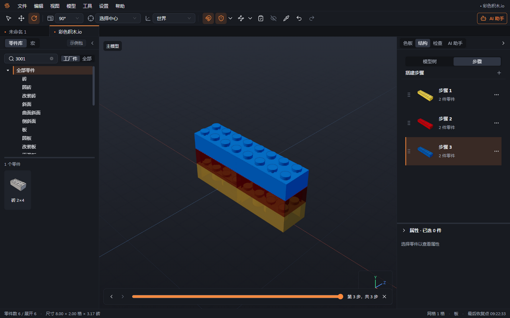

# 11 宏与搭建步骤

本章你将学会：把常用拼法存成组合宏，查找并插入印刷图案件，安排搭建顺序，并逐步查看模型。

宏是零件库中的可复用内容。“组合宏”是一套已经搭好的组合，例如桌椅；“图案宏”用于分组浏览已有印刷件，例如表情、键盘或屏幕，不会把任意图片直接印到零件上。

## 将所选保存为组合宏

1. 在模型中选择需要重复使用的组合，先核对零件、颜色与连接。
2. 使用右键菜单或“编辑 → 将所选保存为宏”。
3. 填写名称，选择“家具”“门窗”“植物”“交通”“其他”，也可填写自定义分类。
4. 选择缩略图采用中性灰或保留原色，确认保存。软件自动生成缩略图，将组合存为 `.brklmacro`，保存在本机用户宏目录。
5. 切换左栏“宏”标签，按名称搜索，确认保存的组合可用。

保存宏后，原工程仍需要单独保存。宏是插入时使用的资源，后来修改原工程不会自动更新已保存的宏或其他工程中的副本。

## 插入组合宏

1. 在“宏”标签选择分类或搜索名称。内置示例包括桌子、椅子、床、书架、门和路灯，使用示例包中的零件与颜色。
2. 在插入方式中选择“编组”或“子模型”，默认是“编组”。编组便于直接选取内部零件，子模型便于组织为完整部件。
3. 双击缩略图或拖入视口，进入放置预览。按普通零件的方式旋转、吸附和放置，Esc 取消。
4. 如插入前提示某些零件或颜色不在当前包中，先判断是否需要替换；插入后在检查面板处理相关问题。
5. 若要让同一工程中的多个副本联动，插入为子模型后使用“再放一个”。重新从宏库插入会建立新的内容，不应当作原子模型的共享引用。

内置“门”是固定门板与门框的示例组合，不含可动铰链。含自制件的宏在另一台电脑上使用时，还需提供相应数据包与几何资料；宏只保存零件引用，不附带自制零件几何。用户宏位于 `%APPDATA%\Brickloop\macros`。

## 使用图案宏

1. 在“宏”标签中打开“图案”分类。
2. 根据用途浏览“人仔表情”“衣服（躯干）”“衣服（腿）”“屏幕与显示”“报纸与文字”“键盘与按钮”“标志与其他”。
3. 查看按印刷原色呈现的缩略图，选择需要的零件，双击或拖入视口放置。
4. 核对工厂能否生产这个具体印刷件。基础件可生产，不代表带图案版本也可生产。

## 安排搭建步骤

1. 在右侧“结构”切到“步骤”视图，查看步骤编号、零件数和缩略图。新建模型默认有一个步骤。
2. 使用“添加步骤”建立下一步，再将其设为当前步骤。之后新放置的零件默认进入当前步骤。
3. 选中已有零件，在目标步骤的操作中使用“把所选移到此步骤”，将所选内容移动到该步骤。
4. 拖动步骤调整顺序，也可使用“上移”“下移”。重新排列后检查前后遮挡与实际可搭顺序。
5. 使用“删除步骤”移除不再需要的步骤，其中零件会并入相邻步骤（通常为前一步；首步并入后一步），界面会提示并入件数与目标步骤。只剩一步时不能删除。步骤操作可撤销；遇到不符合预期的结果立即 Ctrl+Z。

## 逐步查看

1. 选择“视图 → 逐步查看”或按 Ctrl+Shift+P。
2. 视口显示到当前步骤为止的累计零件，保留当前步骤新增零件的真实颜色，并压暗之前步骤的零件，便于区分新增部分。
3. 使用底部“上一步”“下一步”或滑块检查整个搭建过程，尤其留意需要先插入、后封闭的位置。
4. 退出“逐步查看”恢复正常编辑。调整步骤后，可按[第 10 章](10-说明书.md)导出说明书。

下一章：[AI 助手](12-AI助手.md)。
