# 12 AI 助手

本章你将学会：选择 AI 接入方式，配置模型和费用限制，说明修改要求，并审阅、保留或撤销一轮修改。

## 选择接入方式

API Key 是服务商签发的访问密钥，用于授权请求并计费。Brickloop 内置助手与外部智能体是两种入口；本章介绍内置助手，外部客户端连接见[第 14 章](14-外部智能体（MCP）.md)。

| 方式            | 如何连接                                                               | 用量与费用                                                          |
| --------------- | ---------------------------------------------------------------------- | ------------------------------------------------------------------- |
| API Key         | 添加 OpenAI、Anthropic、Gemini 或“OpenAI 兼容服务”，填写密钥与服务地址 | 按对应 API 账户或服务商规则计费；显示估算费用                       |
| 用 ChatGPT 登录 | 点击“Continue with ChatGPT”，在系统浏览器完成授权                      | 符合条件的请求使用你自己的 ChatGPT 套餐额度；界面显示“使用套餐额度” |
| 本机模型        | 选择“OpenAI 兼容服务”，连接本机 Ollama、vLLM 等兼容服务                | 由本机服务处理，模型能力与可用资源由本机配置决定                    |

ChatGPT 登录能否获得套餐使用权限，以实际授权结果为准。套餐额度用尽时会暂停，**不会自动改用 API Key 或其他计费方式**。需要更换服务商时，由你主动选择。Anthropic 接入使用 API Key，不提供 Claude.ai 账号订阅登录。

## 配置 API Key 或 ChatGPT 登录

1. 没有选择时按 Ctrl+K 打开“AI 助手”，点击“AI 设置”，或使用“设置 → AI 设置”进入设置的“AI”页。
2. 先选“用账号登录”或“使用 API Key”。没有服务时，这两个入口直接显示在页面上；已有服务时，点击“添加”选择方式。随时可以返回上一步，编辑已有服务会直接打开填写界面。
3. 使用 API Key 时，搜索并选择服务商。预设包括 DeepSeek、通义千问、豆包、Kimi 开放平台、智谱、硅基流动、MiniMax、腾讯混元、百度千帆、OpenAI、Claude、Gemini、OpenRouter，以及本机 Ollama、LM Studio、vLLM。常见服务只需粘贴 Key；“去获取 API Key ↗”在系统浏览器打开对应密钥页。本机预设无需 Key，请先启动服务并加载模型。
4. 在同一个表单中点击“测试连接”。软件先读取模型列表，再发送最小请求。成功后显示用时和模型数，并按推荐规则预选模型；可在下拉框搜索其他可用模型，查看看图和工具调用能力，再点击“保存”。首个服务自动设为默认，并填入三个用途的模型。测试尚未通过时，普通“保存”不可用；“不测试直接保存”需确认，服务会标为“未测试”。
5. 账号登录选择 ChatGPT，点击“Continue with ChatGPT”，在系统浏览器完成授权。回到积环后会自动测试并列出模型，选择后保存。**Kimi 会员、Claude、Gemini、GitHub Copilot 和国内编程套餐不提供账号登录**：这些订阅未授权本软件通过账号登录使用额度；Kimi 的账号授权仅用于其官方 CLI，会员 Key 面向编程工具。积环接入 Kimi 使用按量付费的开放平台 Key，可点击“改用 API Key”切换方式。在“按用途选择模型”中，可修改“对话与搭建”“视觉理解”“快速任务”。搭建需要工具调用，看图需要图片输入；未确认的模型能力以服务商文档和本机模型配置为准。
6. 开始请求前，核对 AI 面板顶部的“服务商”“模型”和“深度”。“快速”“均衡”“深入”用于调整处理深度，并不保证所有服务商的耗时相同。对 DeepSeek Flash，三档说明显示在“深度”下拉层里，每个选项分两行显示档位名和灰色说明：“快速”关闭思考、回复最快，“均衡”保持服务商默认，“深入”开启最大强度思考；其他服务商的处理深度仍按各自的适配决定。

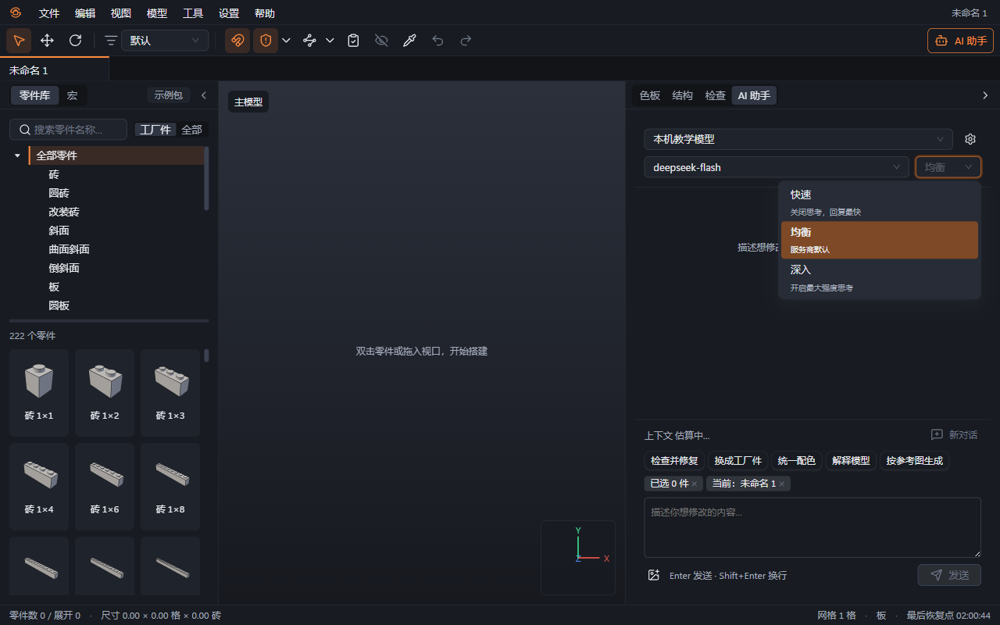

服务卡片显示接入方式、当前模型，以及“可用 / 未测试 / 连接失败 / 需要重新登录 / 需要重新填写”状态。“需要重新填写”表示已保存的 Key 无法读取（例如密钥所在的 `session` 文件夹被删除或换了电脑账户）：设置页照常打开，点“编辑”重新粘贴 Key、测试并保存即可，不需要删除服务；此时 Key 不能留空沿用。实心星标和“默认”文字表示当前默认服务；其他卡片可点击空心星标设为默认。卡片上的测试使用同一套连接测试，结果显示在对应卡片内，成功时显示连接用时。ChatGPT 卡片将账号与操作分成两行，提供切换账号、退出登录、添加账号和管理套餐用量；点击账号可设为当前账号。同一账号重新授权不会重复建立服务。退出后保留服务配置，点击“重新登录”重新授权。整体关闭 ChatGPT 登录的开关位于本页“高级设置”。

表单中的“高级设置”默认折叠，可修改显示名称、服务地址、代理、手动模型名和自定义价格。通义千问和 Kimi 提供国内／海外地址切换，Key 须与服务区域匹配；只有“自定义（OpenAI 兼容）”可以更改协议。服务商不提供模型列表时，按提示手动输入模型名，再测试。密钥在本机加密保存，列表仅显示后四位；编辑时 Key 留空会沿用已保存的密钥。未保存的测试配置只在内存中使用，取消编辑不会替换原配置。

连接失败时，提示会区分 Key 或权限问题、余额不足、地址或模型不对、请求过频／额度耗尽和网络问题，并给出处理建议。展开“详细信息”可查看状态码和经过密钥遮掩的服务商原文。旧版配置会自动归到对应接入方式和预设，原密钥、账号、地址和默认设置保持不变。

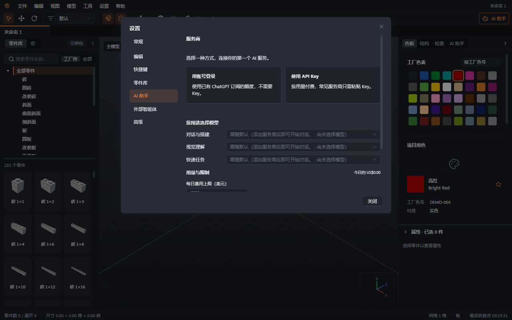

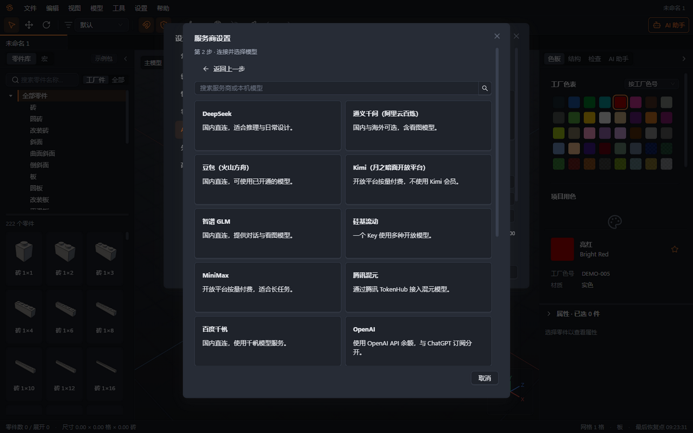

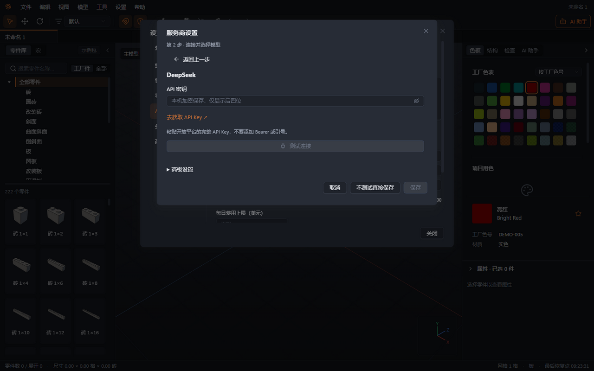

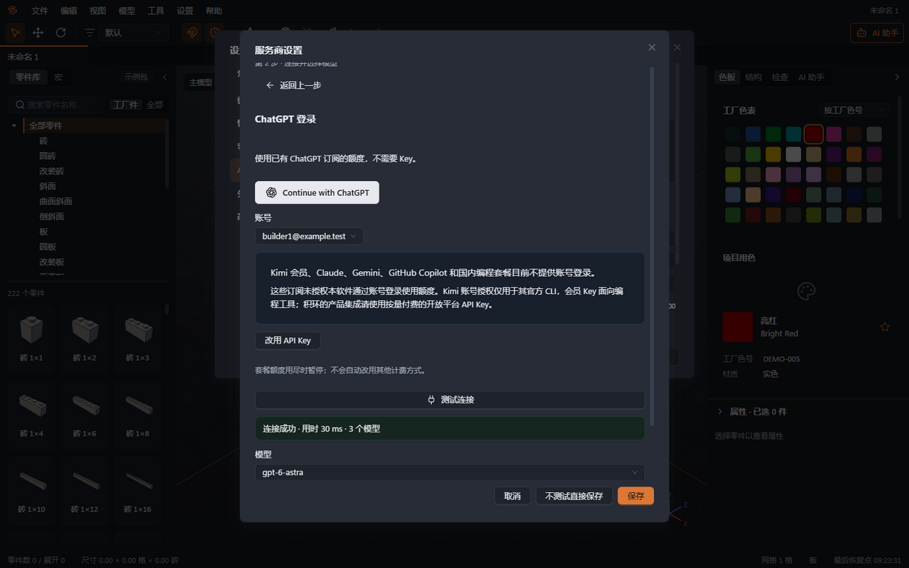

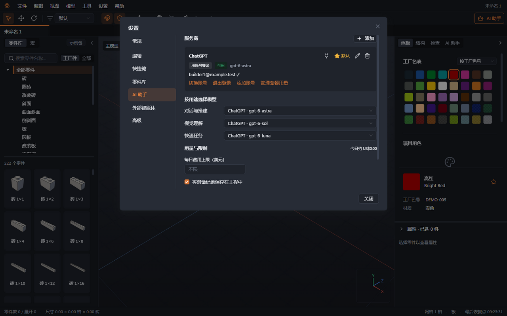

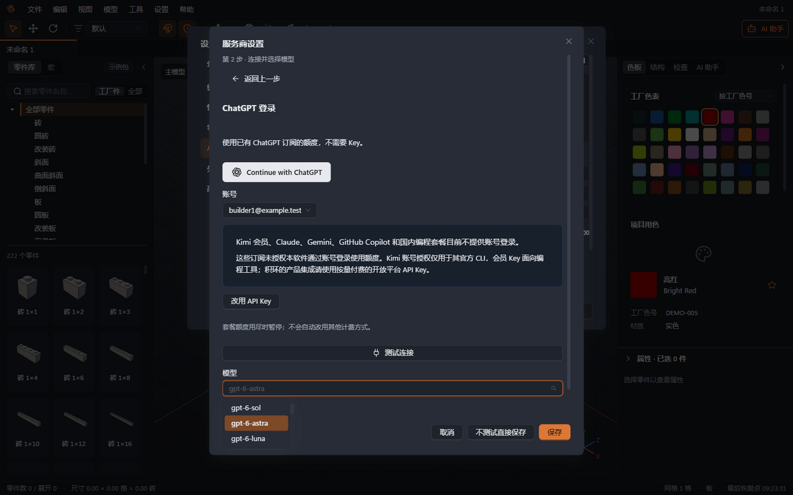

截图使用本机模拟授权和虚构账号 `builder1@example.test`，没有使用真实账号或密钥。实际可用模型以你的账号返回的列表为准。

## 设置费用与操作限制

1. 在“用量与限制”填写“每日费用上限（美元）”；使用“不限”表示不以此项限制 API 请求。
2. 核对所选模型的价格。自定义模型可在服务商设置中填写输入、输出、缓存读取的每百万字元价格；“未配置模型价格”表示无法估算，不表示免费。
3. 普通对话默认不限制每轮的操作次数和时长，模型做完会自行结束，你也可以随时点“停止”。需要硬上限时，展开“高级”填写“每轮操作上限”和“每轮时长（分钟）”。看图搭建的上限在它自己的对话框中设置（见[第 13 章](13-看图搭建与马赛克.md)）。
4. 每轮结束查看输入／输出用量与“约 US$…”费用。达到每日费用上限后，后续请求会停止或暂停；已经发出的请求仍可能产生费用，估算上限不能代替服务商的账单或账户限额。

每日统计按电脑的本地日期累计，在本地午夜换日。跨午夜的请求计入请求开始时的日期。ChatGPT 登录显示套餐用量提示，不按 API 美元估算扣减套餐；套餐上限由服务方决定。

“测试连接”会发送一次最小模型请求，可能产生服务商费用。这类连接测试的估算费用也计入每日账本，并受每日费用上限拦截。已达到上限，或启用上限但尚未配置模型价格时，不会发出测试模型请求；测试时同样要留意服务商账户的额度。

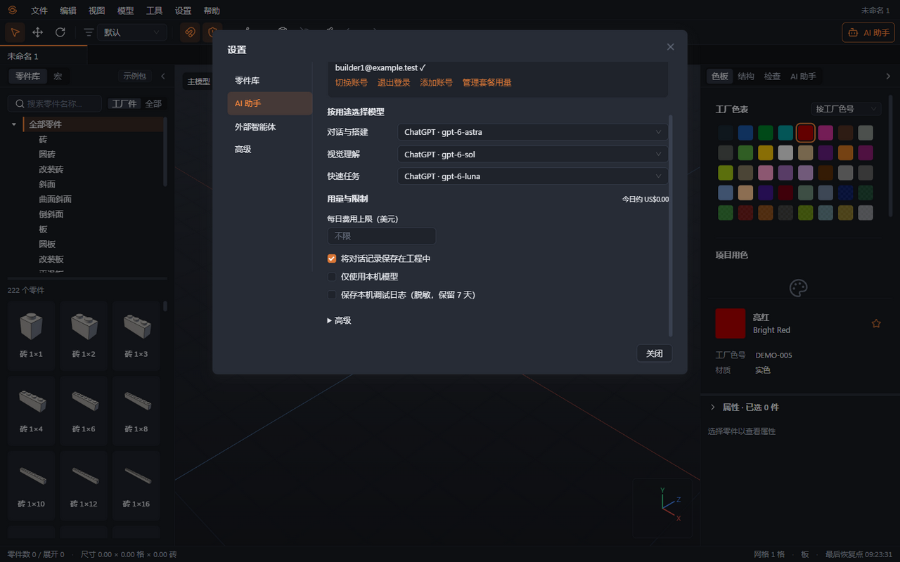

## 并行任务、预览与合并

默认同时运行 3 个任务，可在 AI 设置的“同时运行的 AI 任务”中改为 1—5。超过上限的任务显示“排队”，有空位后自动开始；每个文档同时只运行一个看图搭建任务。每轮使用各自的操作次数和时间预算，API 费用计入同一每日账本。

任务卡显示状态、调用数、耗时和费用。“预览”把 AI 当前结果半透明叠加在视口中，删除的零件用红色虚线框标出。预览不能选中，不影响编辑；同时只显示一个任务，默认显示当前文档最近启动的任务。

任务运行期间编辑过文档时，卡片会显示“新增 N · 修改 N · 冲突 N”。点击“合并”时会按最新文档重新计算；不需要结果时可“丢弃”。不同实例的修改自动合并；同一实例被双方改成不同结果时，保留你的版本，在审阅的“冲突”组选择“用 AI 版本”或“保留我的”。“用 AI 版本”覆盖整个实例，并可撤销。合并后新出现的碰撞等问题数量显示在审阅栏。

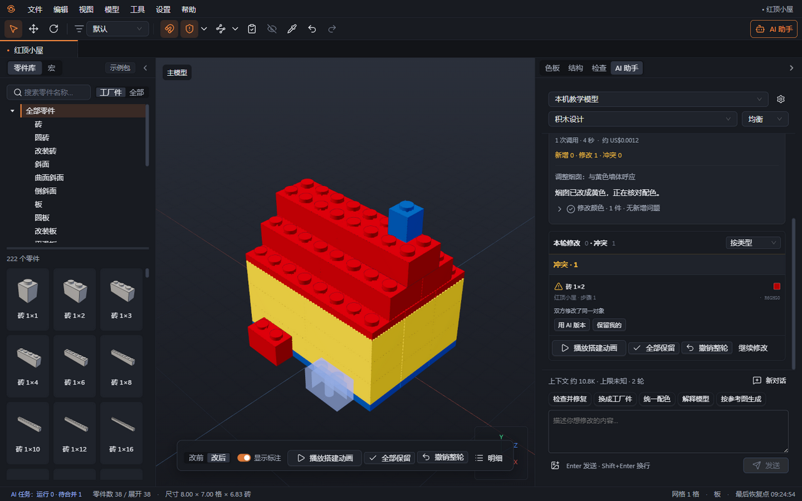

状态栏显示运行和待合并数量，点击可打开 AI 面板；面板隐藏时出现新结果，AI 标签会显示圆点。关闭文档或退出时，软件先提示停止并丢弃未完成任务。工作副本不保存、不进入恢复记录；运行中和待合并的任务不会在重启后恢复。已合并的修改按正常工程方式保存。

## 选中即提问与 @ 引用

在视口中选择零件，点击包围盒上方的“问 AI · Ctrl+K”，或在视口、编辑区有焦点时按 Ctrl+K，就会打开就地输入条。没有选择或焦点在其他区域时，Ctrl+K 打开 AI 面板并聚焦消息框。拖动、放置、锁定和“改前”状态下不会显示提问按钮。

输入条沿用 AI 面板的服务商、模型和深度。“只改选中部分”默认开启：AI 只能修改任务开始时选中的实例及其后代，也可以新增零件并修改本轮新增件。移动、重组后仍按起点范围判定。共享子模型内部的修改若会影响未选中的出现位置，会被拒绝；AI 可以先将选中的子模型独立，再修改内部。关闭开关后，选择只用作上下文。外部 MCP 操作不受这个开关影响。

按 Enter 发送后，可立即继续编辑或再选一块提问。每个任务有自己的状态小条和“停止”按钮，最多显示 3 条，其他任务可在 AI 面板查看。小条跟随任务起点的位置，右栏保持原来的标签；AI 标签不可见时出现未读圆点。任务完成或停止后，按前述规则直接应用或等待合并，合并后进入三维审阅。对话中的用户消息带“选中 n 件”标签。

两个输入框都支持输入 `@` 引用选中部分、子模型、当前模型的步骤、工程用色和参考图。继续输入可筛选，上下键选择，Enter 或 Tab 插入，Esc 关闭候选；候选关闭后，Esc 可关闭就地输入条。标记仍是普通文字，删除标记就不会发送该引用。`@选中` 在发送时读取当前选择；引用对象已删除时，软件会提示并移除引用。

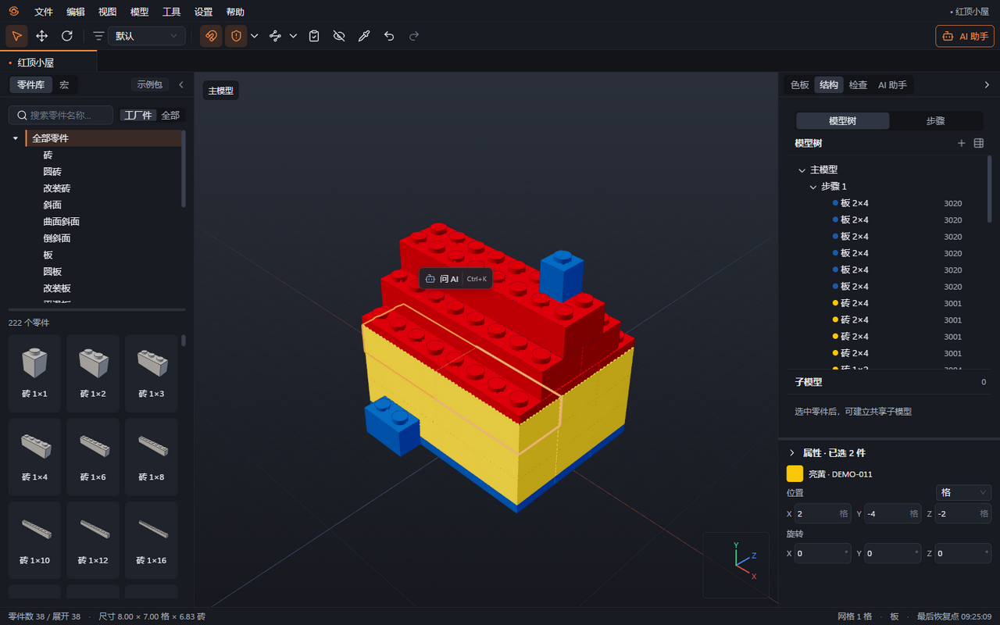

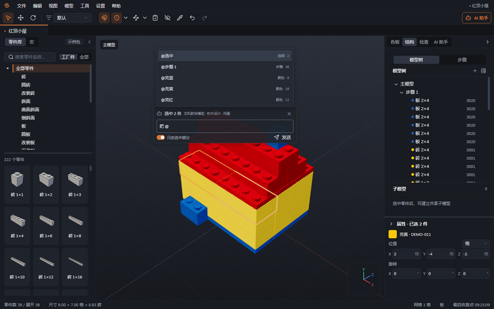

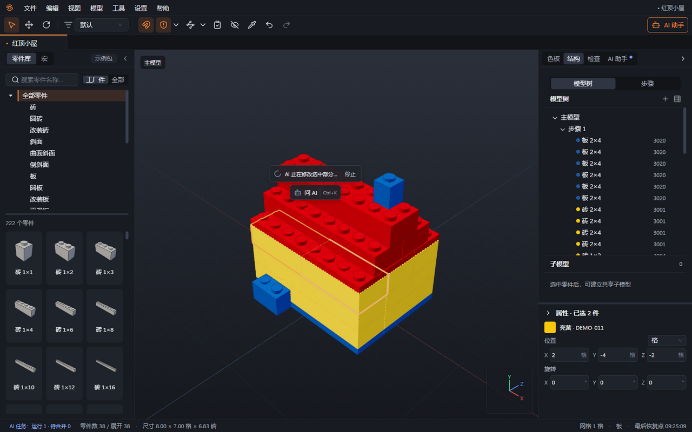

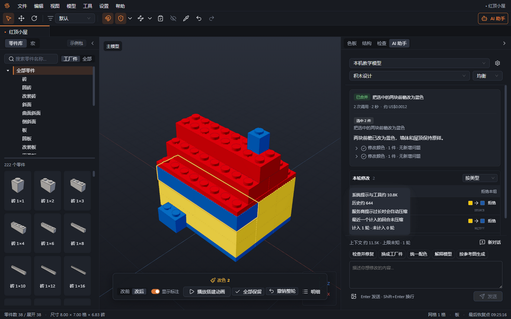

## 图片、记录与仅本机模式

1. 首次向某个云端服务商发送图片时，阅读“发送图片前确认”，核对服务商名称和数据去向；图片包括添加的参考图与模型渲染图。
2. 点击“允许”继续发送，或“拒绝”取消这次图片发送。文字、模型摘要和查询结果会按当前请求发送给选定服务商，发图提示不代表文字请求无需外发。
3. 需要所有内置模型请求留在本机时，勾选“仅使用本机模型”，并选择本机兼容服务，例如 `http://127.0.0.1:11434/v1`。该选项会拒绝云端地址和 ChatGPT 登录，不会自动下载或启动本机模型。
4. 按需要设置“将对话记录保存在工程中”。关闭后不再追加记录，不应把它当作清除已有记录的按钮；想让 AI 不再参考之前的对话，请使用“新对话”（见下文“对话上下文与新对话”）。分享工程前核对参考图和已有对话内容。
5. 排查问题时可启用“保存本机调试日志（脱敏，保留 7 天）”。日志只记录事件类型、用量、停止原因、错误类别、代码和 HTTP 状态，不记录提示词、服务商说明原文和密钥。不要在聊天消息或反馈附件中粘贴密钥。

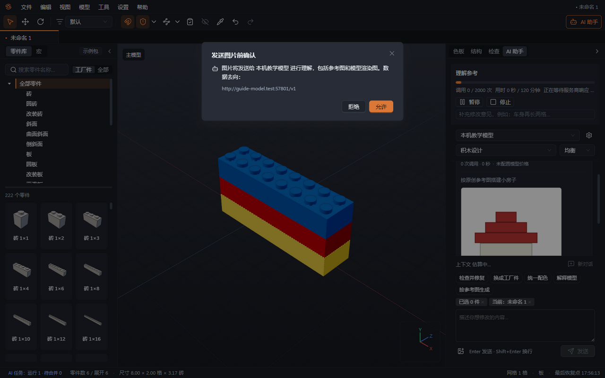

此图为无账号的教学演示，实际提示以当前服务商名称和地址为准。普通本机回环服务不会触发云端图片确认。

## 提要求并审阅结果

1. 选中要处理的零件，必要时进入相应子模型；在输入框上方核对“已选 N 件”和“当前”范围。
2. 写清目标和限制，例如：“只修改选中的屋顶，把红色换成当前工厂可生产的深灰色，保留其他结构，完成后检查。”也可点击“检查并修复”“换成工厂件”“统一配色”或“解释模型”。
   - 点“检查并修复”或“换成工厂件”并直接发送（没有改动提示文字、没有图片和 @ 引用）时，积环会先在本机检查当前范围（选中的零件，或没有选中时的整个文档）。**没有发现任何问题时不会请求模型**，对话里直接出现一条“本地检查，未调用模型”的结果，写明范围和各项检查的数量；这条记录会和普通回合一样保存、计入之后的上下文，不计费。需要模型再看一遍时，点这条记录上的“让 AI 再检查一次”。发现问题，或本机检查无法确定时，会照常交给模型处理。

   - 点“统一配色”并直接发送原始提示时，当前范围内只有一种颜色或没有零件，就不会请求模型，对话里会出现本地回合，带“让 AI 再检查一次”按钮。直接发送“统一配色”或“解释模型”的原始提示、需要请求模型时，积环先在本机统计当前范围，随第一条请求发给模型；用户消息上显示“已附本地统计”标签，可展开查看。统计超过 1 秒或计算失败时不附带，照常发送；准备期间发送按钮显示加载状态。改过提示文字、带图片或 @ 引用时，不做这些处理。

   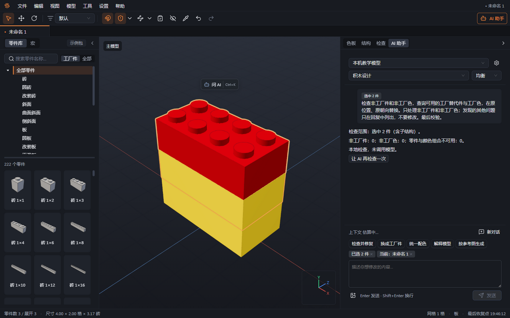

3. Enter 发送，Shift+Enter 换行。需要图片时点击“添加图片”，最多 8 张，每张不超过 10 MB。
4. 每轮请求建立一个独立任务。AI 在工作副本上执行，你可以继续编辑当前文档、切换标签，也可以发送新的任务。工具活动按任务分别显示。
5. 想中断时点击对应任务卡的“停止”。已完成的修改保留：任务期间未编辑文档时直接应用；有过编辑时进入“待合并”。点击“合并”后进入审阅。
6. 在视口底部的浮动审阅栏查看本轮摘要。零件保留真实颜色：新增件用绿色描边，改色和换零件用琥珀色描边；移动件在新位置用蓝灰色描边，并从原位置的残影画箭头指向新位置。删除件显示带红色边线的半透明残影。选中时优先显示选中描边；可用“显示标注”开关暂时隐藏审阅标注。
7. 点击“明细”进入 AI 面板中的审阅列表，选择“按类型”“按子模型”或“按步骤”分组。悬停一项可加强视口高亮，单击可选中并对准该零件；已删除的项只对准位置。每组超过 200 项时，点击“再显示 200 项”继续查看。
8. 对不需要的变化点击“拒绝”，或在组标题点击“拒绝本组”；已拒绝的项可点击“恢复”。每次操作都可用 Ctrl+Z 撤销。拒绝会还原该实例的整项变化，包括它的移动、颜色和其他字段。
9. 使用“改前 / 改后”比较整轮结果。“改前”只读显示事务前的文档，并保持相机和选择；编辑入口和 AI 输入框禁用。按 Esc、切回“改后”或切换文档标签即可退出。
10. 完成后点击“全部保留”结束审阅，或选择“撤销整轮”；“继续修改”聚焦输入框，合并下一轮结果时结束旧审阅。再运行检查并保存工程。

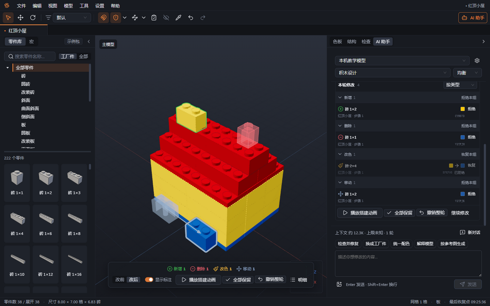

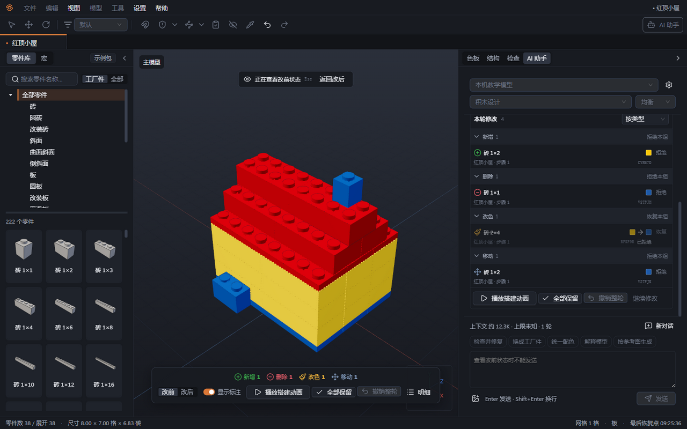

一轮 AI 修改合并为一个撤销点，拒绝和恢复各产生一个新的撤销点。“撤销整轮”会撤销本轮 AI 和随后产生的审阅操作；如果之后已有其他修改，该按钮禁用并提示使用撤销历史。只读问答不会产生修改撤销点。

每项的“已接受”“已拒绝”“已被后续修改”由当前文档推导，撤销、重做会自动更新。已被后续修改的项不能单独拒绝或恢复。子模型、步骤、编组、资源和工程信息列在只读“结构”组，只能随整轮撤销；还原所需步骤或模型已不存在时，也请撤销整轮。

修改共享子模型中的一件零件，列表只显示一项，视口会标注所有出现位置。审阅会随文档标签保留，但只在当前会话中有效，不写进工程文件。外部智能体（MCP）的修改暂不进入这套审阅。

## 对话上下文与新对话

同一个工程中，每次提问都会带上之前正常结束的回合，AI 因此记得前面谈过什么。输入框上方的“上下文”一行显示下一次请求大约会带多少内容。

- **数字的含义**：下一次请求约有多少 token，包括系统说明、工具定义、模型摘要和计入的历史回合，不含你正在输入的文字。模型的上下文上限已知时，会显示上限、百分比和进度条，例如“上下文 约 12.3K / 1M · 1% · 3 轮”。上限未知时显示“上限未知”。
- **查看明细**：鼠标停在数字上，可以看到系统说明与历史各占多少。软件按模型的真实上下文上限工作，只在快到上限（约预留 15%）时，才让模型把较早的回合总结成一份摘要（目标与限制、设计约定、已完成的部件、未完成项、关键数值），最近的消息仍然原样保留，并提示“下次请求会压缩较早内容”；最近一轮已经这样压缩过时，显示“已压缩”。摘要保存在工程里，保存后重新打开仍然有效。上限未知的模型，只有服务商提示“内容过长”时才压缩，然后自动重发。DeepSeek 要求回传模型的思考内容，所以在 DeepSeek 上，之前的回合总是以摘要形式发送。
- **哪些回合计入**：正常完成的回合计入；看图搭建只计入文字摘要，不再发送参考图。因错误停止、但已经保留了修改的回合（例如放置了零件之后断网），以摘要计入：AI 能看到你的请求、失败原因和已经完成的修改数量，卡片上标“已以摘要计入”。以下回合不计入，卡片上标“未计入上下文”，鼠标停在标签上可以看到原因：
  - 失败但没有任何修改的回合；
  - 中途停止的回合；
  - 输出被截断的回合；
  - 超出时长或费用上限的回合；
  - 结果被丢弃的任务。

**开始新对话**：想让 AI 忘掉之前的讨论时，点击“上下文”一行右侧的“新对话”，确认后生效。

- 之后的请求不再包含本工程之前的回合。
- 之前的记录仍然保留，折叠为“之前的对话 · N 轮 · 未计入上下文”，点开可以查看。
- 模型、审阅和撤销记录都不会改变；这一步本身也不进入撤销记录。
- 工程标题会显示未保存。保存后，重新打开工程仍然有效。
- 本工程有任务正在运行或排队时不能使用。

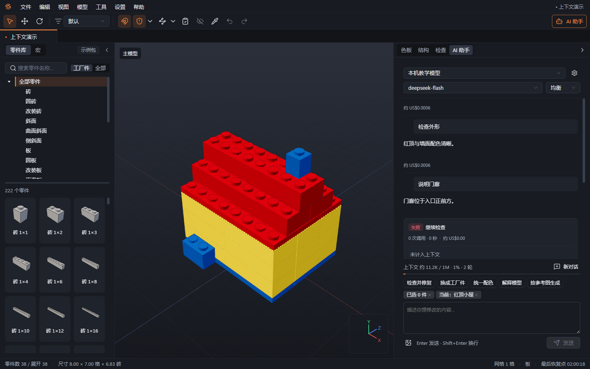

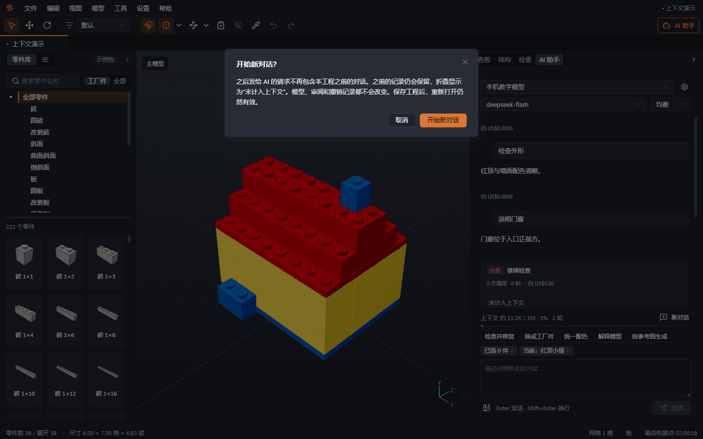

## 任务运行中：模型是否还在工作

模型在“思考”和写长脚本时，一次请求可能要几分钟，思考模式的模型（例如 DeepSeek）尤其明显。对话回合和看图任务卡在运行时都有一行状态，告诉你模型是否还在工作：

- **有数据时**：“模型正在思考／生成回复／生成脚本 · 已生成约 12.3K 字 · 3 秒前有数据”。字数包括思考内容，只要它在增加，就说明模型在工作，不是卡住。
- **刚发出请求**：“正在等待服务商响应 · 已 N 秒”。
- **超过 60 秒没有收到任何数据**：这一行变成警告，“已 N 秒没有收到数据，仍在等待服务商响应，可以点击停止”。服务商繁忙排队时可能出现，等待通常无害。收到数据后立即恢复。
- **只有保活信号**：服务商繁忙排队时会一直发送“还在处理”的保活信号。这时显示“服务商正在排队或处理，连接正常”，不是警告，也不会被当成无响应。
- **超过 10 分钟没有收到任何信号**（连保活信号也没有）：软件会自动终止这一次请求并重发（这类情况最多重发 3 次）；仍然没有响应时任务停止，提示“服务商长时间没有响应”。不想等时随时点“停止”，已完成的修改会保留。
- **自动重试的等待期间**显示“N 秒后第 k 次重试（最多 10 次）”。如果服务商要求等待更久（响应里带有等待时间），按它要求的时间等；任务暂停和结束后这一行不显示。
- 这一行放在任务卡已有的信息行里，不会让卡片变高；文字太长时单行省略，鼠标停在上面可以看到完整文字。

这一行只显示数量和时间，不显示、也不保存模型的思考内容。

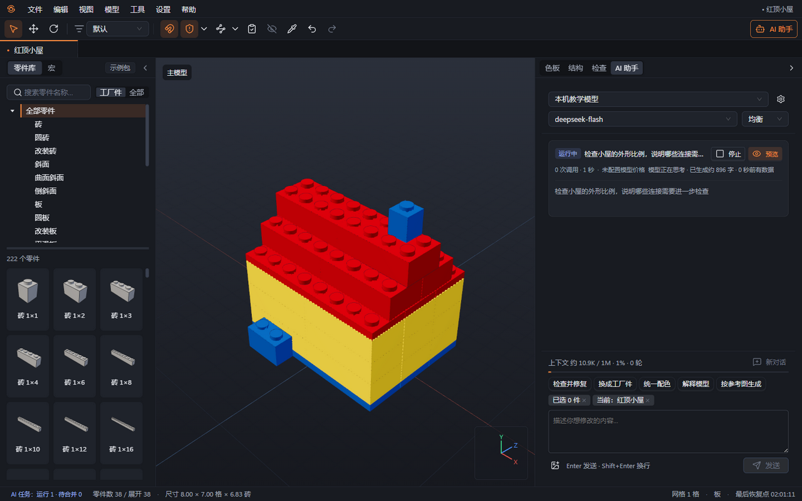

## 失败时查看原因

一轮没有正常完成时，回合结尾会显示原因，失败提示也会写明原因：

- **原因类别**：例如认证失败、余额或额度不足、请求被限流、网络连接中断、请求被服务商拒绝、服务商错误、服务商资源不足、模型输出达到长度上限。
- **服务商返回的信息**：错误代码、HTTP 状态码，以及一段遮掩过密钥的服务商说明，多为英文。
- **处理建议**：一句对应的建议。

网络中断、服务端错误、限流时，软件会先自动重发失败的那次请求：间隔从约 2 秒开始逐次加倍，每次不超过约 10 秒，最多重发 10 次（超时类最多 3 次）；服务商要求等待更久时按它要求的时间等。仍然失败才停止。停止时，已经完成的修改会保留并进入审阅，不需要时点“撤销整轮”。余额不足时（HTTP 402）请先到服务商控制台充值。

看图搭建的报告还会写明失败发生在哪个阶段（结构计划、准备或第几轮）、尝试了几次，见[第 13 章](13-看图搭建与马赛克.md)。向同事或服务商反馈问题时，附上错误代码、状态码和请求 ID 即可，不要附 Key。

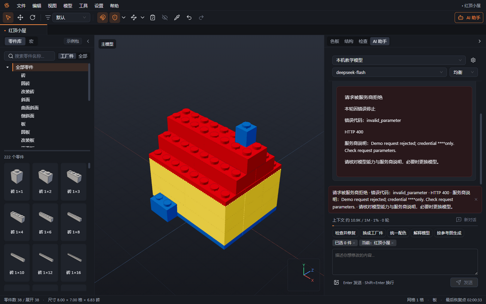

## 搭建脚本

墙、地面、塔身、屋顶、地形和成排植物可以让 AI 用搭建脚本一次生成。单个零件的移动、改色和连接调整仍使用逐件工具。写脚本前，助手会读取相关范例和设计指南；运行后应查看连通性、薄弱连接等警告，并用渲染图或文字层图检查结果。

对话默认使用工厂件；看图搭建默认可使用全部 LDraw 零件作概念设计。每次脚本输出在 AI 任务的工作副本中生成，完成后按正常合并和审阅规则进入工程。同一个脚本重新运行时，只替换它仍带来源标记的输出，其他零件保留。“只改选中部分”开启时，将被删除的旧输出也必须属于任务起点的选区或本轮新增件；共享子模型的其他出现位置也会参与判断。

结构面板中的脚本子模型带“脚本”标记。右键可选择“查看脚本”，在只读代码窗口中查看名称、零件范围、种子和上次运行统计，并复制代码；也可以选择“重新运行”或“转为普通零件”。转为普通零件会解除这个脚本对现有输出的替换关系，代码仍保存在工程中。

手工修改或删除过脚本输出后，从界面重新运行会提示“这些修改会被覆盖”。选择“转为普通零件后运行”可保留原有实例，再生成新输出；选择“仍然覆盖”则替换原输出。AI 在工作副本中运行时不弹此窗口，与你同时修改的内容按三方合并规则处理。

代码与运行设置随 `.brkl` 工程保存，重新打开仍可读取和运行。导出 Studio `.io` 只导出模型，不附带脚本。

下一章：[看图搭建与马赛克](13-看图搭建与马赛克.md)。
