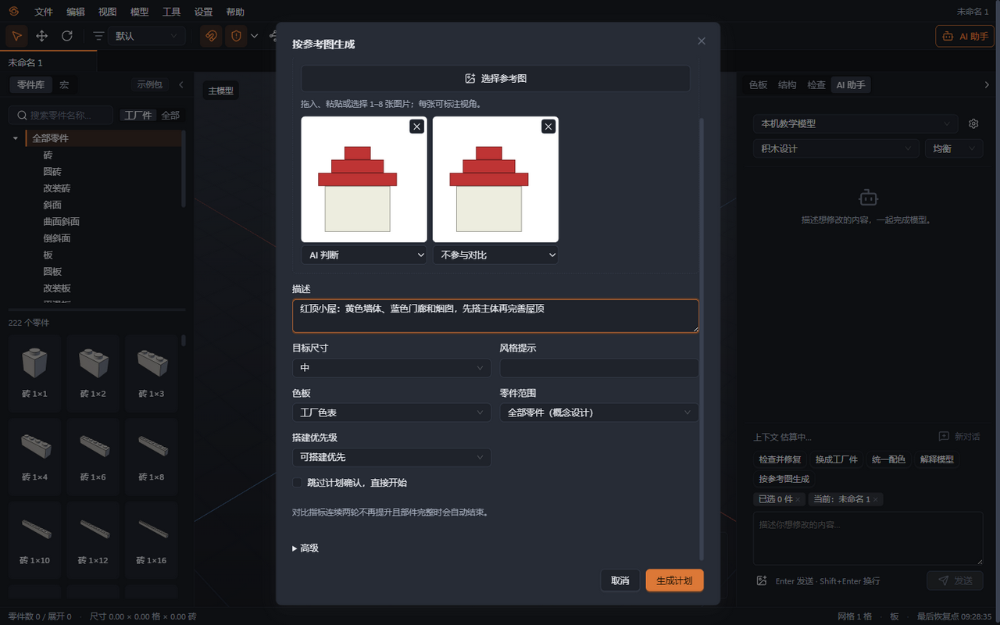
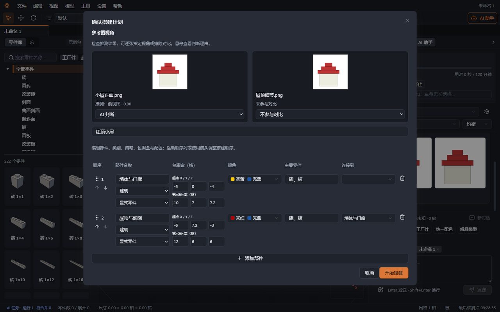
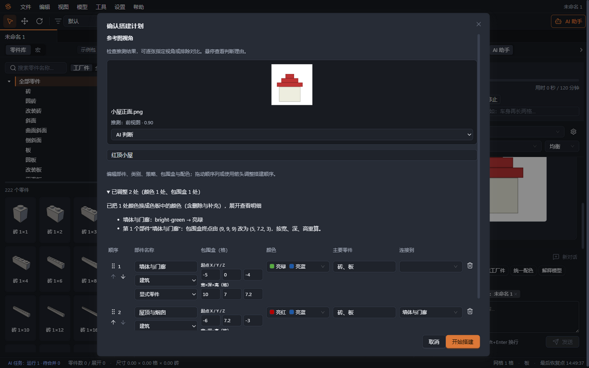
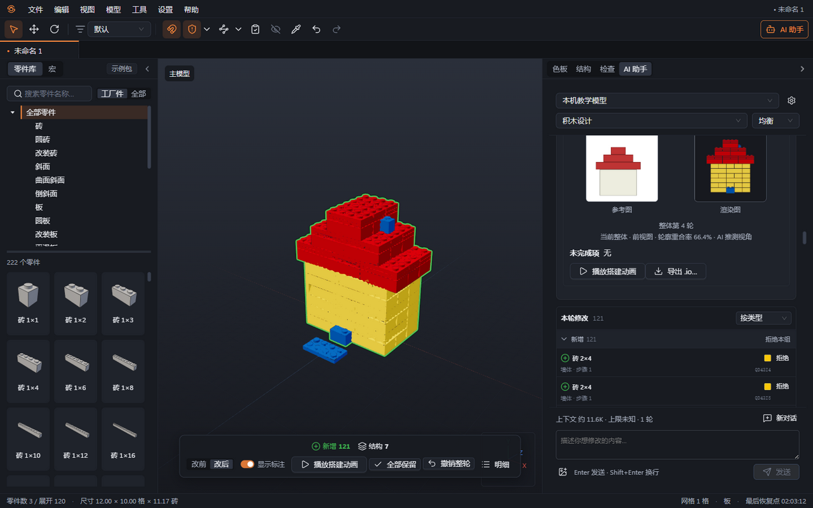
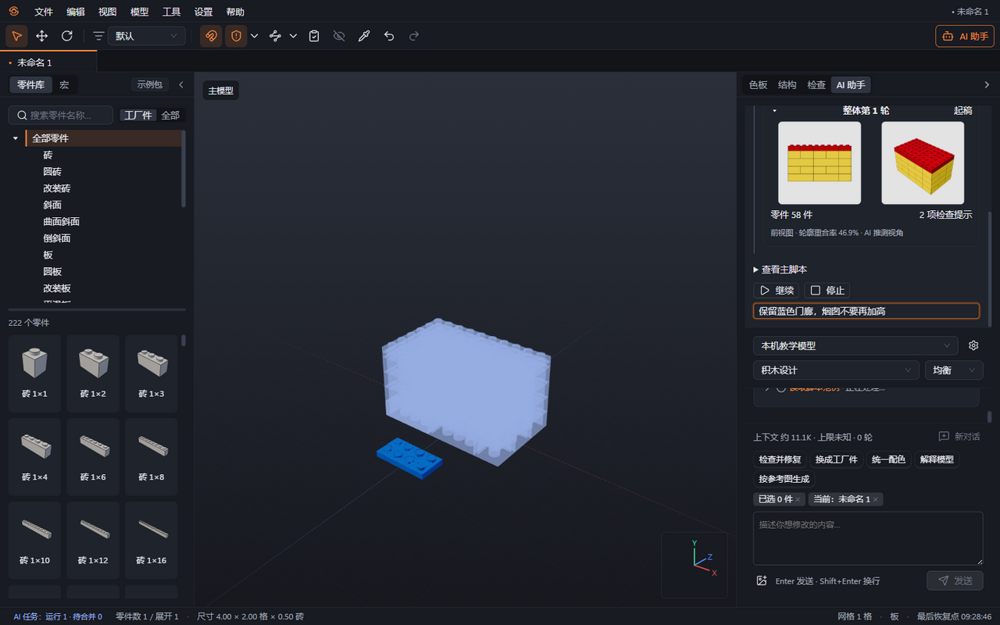
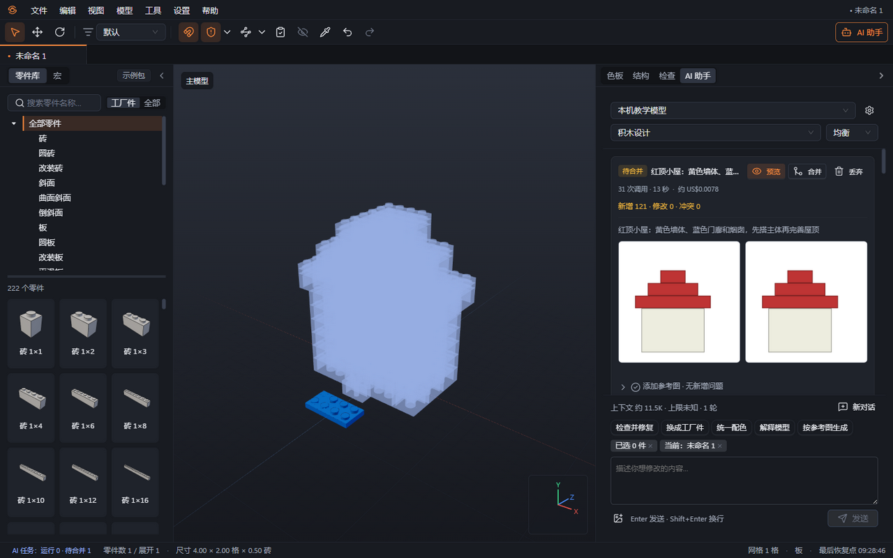
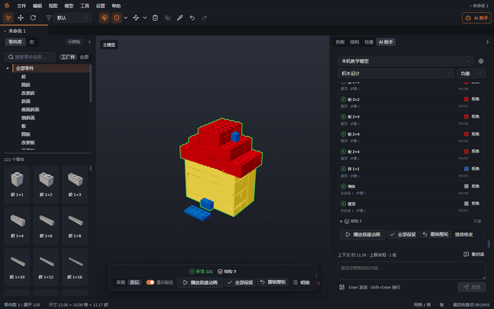
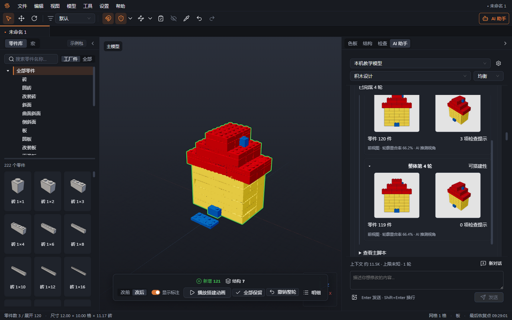

# 13 看图搭建与马赛克

本章你将学会：准备容易理解的参考图，编辑搭建计划，设置次数与时间预算，阅读轮廓对比，并将图片转换成平面马赛克。

看图搭建由 AI 理解物体结构，再用一个主搭建脚本生成整体初稿，经过“运行 → 渲染 → 对比 → 改脚本”多轮调整。脚本输出仍是可编辑的零件和子模型。马赛克将图片转为平面色块，不调用大模型，适合标志、画面和装饰板。

## 准备好参考图

1. 使用简单、均匀的背景，避免背景与主体同色、复杂花纹和明显投影。浅色主体（如米白墙体）放在白色背景上也能识别；背景透明的 PNG 按透明度区分主体。粘贴进来的照片常常变成很大的 PNG；发给模型之前，积环会把不含透明像素的 PNG（以及 WebP、GIF）压缩成 JPEG（质量 0.9），请求通常小一个数量级，原图仍原样保存在工程里。有透明像素的图片保持 PNG。
2. 主体居中并保留适当边距，不裁掉车轮、屋顶或其他突出部分。物体贴边会影响轮廓识别。
3. 尽量提供同一物体的正面、侧面和顶面；保持配色与结构一致，避免不同图片其实来自不同版本。
4. 默认使用“不固定视角”，每张图由“AI 判断”；也可逐张指定标准视角或选择“不参与对比”。如果已知每张图的朝向，可切换“固定视角”，为每张图标注“前视图”“后视图”“左视图”“右视图”“顶视图”或“斜 45°”，全部选好后才能生成计划。手绘图也可以，用文字补充尺寸、连接方式和看不见的结构。
5. 描述目标尺寸和优先级，例如“宽 8 格，保留圆灯和黑色车轮，先做主体轮廓，尽量少用件”。图片无法准确说明尺寸时，不要让 AI 单凭照片猜测。

本章小屋示例直接使用白色背景的原图（米白墙体、红色台阶屋顶），未做任何处理。四轮依次搭主体、调整台阶屋顶、添加门廊与烟囱、修复连接；最终前视图轮廓重合率为 66.4%。

## 输入要求和预算

1. 选择“工具 → 按参考图生成…”，或在“AI 助手”点击“按参考图生成”。先确认已选择支持图片与工具调用的模型。
2. 拖入、粘贴或点击“选择参考图”添加 1—8 张图片，每张不超过 10 MB；也可只填写文字描述。
3. 设置“目标尺寸”为“小”“中”“大”或“自定尺寸（格）”，明确宽、深、高。这里的尺寸单位是格，AI 工具报告中的高度也可能使用板高，阅读时注意单位。
4. 设置“色板”为“工厂色表”“当前项目用色”或“自选颜色”；设置“零件范围”为“工厂件”“指定分类”或“全部零件（概念设计）”。看图搭建默认使用全部零件；包外内容仍会在检查中提示。选择工厂件时，在最后的可搭建性阶段集中替换。
5. 选择“可搭建优先”（默认），会在末尾修复冲突与悬空；“外观优先”跳过修复，并在报告中保留问题。任务在对比指标连续两轮不再提升、且部件都已建出时自动结束，一般不用设置轮数或时间。
6. 保持“跳过计划确认，直接开始”未勾选，点击“生成计划”。首次发送图片时核对并处理发图确认。

“高级”中有三个安全上限：“迭代轮数”（默认 20，可设 2—20）、“任务时长（分钟）”（默认 120）和“总操作安全上限”（默认 2,000），再加上可选的每日费用上限，共同生效。

- 轮内最多调用 12 次模型工具，包含范例、零件查询和脚本运行。一次脚本运行可以生成多件，自动检查也消耗调用次数。
- 这些上限都不限制最终零件总数。
- 暂停不计入任务时长，等待计划确认计入。
- 达到上限时保留已完成的内容，并列出未完成项。

## 修改并确认计划

1. 在“确认搭建计划”先检查每张参考图的缩略图、推测视角和置信度，例如“推测：前视图 · 0.90”；悬停可查看理由。可逐张改为指定视角，或在不固定视角模式选择“不参与对比”，人工指定始终优先。然后检查模型名称和部件划分，例如底盘、车身、车轮。
2. 直接修改“部件名称”、设计类别（建筑、车辆、植物、地形、人物与小物件）、搭建策略（形状函数或显式零件）、包围盒起点 X/Y/Z、宽深高、颜色、主要零件和连接关系。包围盒使用格，Y 向上；脚本的 y 使用板高，1 格等于 2.5 板高。类别决定后续注入的设计指南和匹配范例。
3. 使用“添加部件”“删除部件”调整内容；拖动“顺序”列，或使用“上移”“下移”安排先后。
4. 删除部件后检查其他行的连接目标；填写正数尺寸和有效颜色。模型写的颜色不在当前色板中时，写法明确的（例如 `bright-green`、`Dark Green`）软件直接换成色板中对应的颜色；拿不准的，先把错误和允许的颜色清单交回模型重写一次，仍然拿不准才换成最接近的颜色。部件的包围盒终点不再由模型写，软件按起点加尺寸推算，所以不会再因为算术对不上而无法开始；打开旧计划或旧工程时，包围盒对不上的部件仍会按宽、深、高重算。这些调整都在表格上方汇总（“已调整 N 处”），点开可以看到每一处的明细。计划仍有问题时，“开始搭建”旁会写明是哪个部件的哪一项，点击即可定位到那一行。
5. 确认后点击“开始搭建”。确认计划前不会开始修改工程。

## 观察、插话与停止

1. 在右侧“AI 助手”任务卡查看“理解 → 准备 → 起稿 → 迭代 → 细节 → 可搭建性 → 收尾”阶段和当前轮次。轮次时间轴保留每轮零件数、检查提示、对比指标和缩略图；点击“查看主脚本”可展开完整代码。
2. 点击“暂停”可在当前操作边界暂停；点击“继续”恢复。
3. 需要调整时，在看图任务面板的“插话”框输入“车身再长两格”等补充要求并按 Enter。新要求在下一轮采纳；暂停时插话不会自动恢复运行。
4. 点击“停止”结束后续工作，已完成的工作副本仍可合并。任务期间可继续编辑，或在其他文档工作；没有人工修改时自动应用，有修改时显示“待合并”，点击“合并”后审阅。任务结束后阅读“搭建报告”，核对件数、颜色数、检查结果与未完成项。
5. 使用视口底部的三维审阅栏比较“改前 / 改后”，在 AI 面板中逐项或逐组拒绝、恢复，再选择“全部保留”“撤销整轮”或“继续修改”。参考图、全部脚本轮次和最终修复属于同一个 AI 修改撤销点，拒绝和恢复另有各自的撤销点；结构变化只随整轮撤销。操作方法见[第 12 章](12-AI助手.md)。
6. 保存 `.brkl`，需要继续在 Studio 编辑时点击报告中的“导出 .io…”。

同一文档的看图搭建任务依次运行，不同文档可以并行。AI 面板的普通输入框会创建新的对话任务；看图任务的暂停、计划确认和插话始终作用于对应任务。

合并后，新增零件进入三维审阅，可在下方审阅栏保留或撤销。

起稿时就生成完整主体，随后调整轮廓、比例和配色，再添加门窗、圆顶、植物等特殊零件。部件较多（超过 6 个）时，首稿先用简单形状搭出每个部件的轮廓，细节在后续轮次补上，这样每次输出的脚本不会过长。每轮自动渲染所有可对比参考视角及斜 45° 视角，并报告冲突、悬空等问题；这些问题不会阻断起稿与迭代。可搭建性阶段集中修复，外观优先则跳过该阶段。

每轮只把计划、当前脚本、上次运行统计与警告、最新一组渲染和对比、逐轮短摘要及插话交给模型。时间轴保留历史图片供设计师查看，旧轮次的工具调用和图片不会持续累积到模型请求中。连续两轮对比指标不再提升且全部部件完成后收尾；达到预算也会结束，并列出未完成项。

报告包含轮数、每轮件数与指标、最终零件数和颜色数、校验结果、各视角对比和未完成项。生成的子模型仍带有脚本来源，在结构面板也可查看、重新运行或转为普通零件。

**中途出问题时会怎样处理**：

| 情况                                             | 处理方式                                          | 报告中的记录                       |
| ------------------------------------------------ | ------------------------------------------------- | ---------------------------------- |
| 模型一次输出的脚本太长，被截断                   | 在同一轮内要求它写更短的脚本或补丁，最多重试 2 次 | 该轮时间轴显示“输出被截断，已重试” |
| 网络中断、服务端错误、请求被限流、服务商资源不足 | 等 2 秒、8 秒、30 秒后重发失败的那一次请求        | 该轮时间轴显示“临时错误，已重试”   |
| Key 无效、余额不足、请求被服务商拒绝、模型拒答   | 立即停止                                          | 报告顶部的失败详情                 |

失败详情写明失败发生的阶段（结构计划、准备或第几轮）、尝试次数、原因类别、HTTP 状态码、错误代码和服务商说明，读法见[第 12 章](12-AI助手.md)“失败时查看原因”。

重试只重发失败的那一次请求，已经执行过的工具不会重复执行。

任务因错误停止时，已经搭好的部分不会丢：没有人工修改时直接应用，有修改时显示"待合并"，之后照常审阅，不需要时点"撤销整轮"。

当前视角还看不到零件时，对比显示 0%，并提示先放置零件或检查位置；这不会被认作搭建完成。参考图没有可识别主体、图片已不存在或视角不一致时，展开“对比参考图”的工具行可查看具体原因和重试建议。

## 怎样理解“轮廓重合率”

轮廓重合率衡量同一视角下，参考图主体与模型渲染主体在画面中的重叠程度：共同覆盖的面积除以两者合计覆盖的面积，结果以百分比显示。例如共同覆盖 60 个单位面积、合计覆盖 100 个单位面积，就是 60%。

它用于比较迭代前后的轮廓，不是作品合格分数。主体位置、比例、视角、背景去除与阴影都会影响数值；算法不会为了提高分数自动把两张图的主体裁齐对正。

前、后、左、右按物体自身朝向定义，顶视图为直接俯视，斜 45° 为从物体前右上方约 45° 俯视。不固定视角模式中，AI 推测为标准视角且置信度达到 0.6 的图片才参与对比，任务面板和对比图会标注“AI 推测视角”。其余图片仍交给模型理解物体，报告中列为“未参与对比”。旧版“未知”按“AI 判断”处理，不会默认按斜 45° 比较。

报告逐图列出视角、来源（设计师指定或 AI 推测及置信度）和最终轮廓重合率。一张可对比图片都没有时，按计划的包围盒和插话调整，不计算 IoU，并继续报告校验结果；报告说明“没有可对比视角，未计算轮廓重合率”。

外轮廓相似仍可能有内部穿模、错误连接、配色差异或工厂不可产的零件。应同时查看并排图、模型检查和未完成项，再做人工精修与试搭。

## 制作马赛克

1. 选择“工具 → 马赛克…”，点击“选择图片”，也可拖入或粘贴。
2. 设置宽高格数；需要保持比例时勾选“锁定图片比例”。桌面入口最大为 256×256 格，尺寸越大用件通常越多。
3. 选择“平滑板”或“圆板”。按需开启“抖动”，用相邻颜色点模拟过渡；平滑板可开启“合并同色相邻格”减少件数，圆板不合并。
4. 查看“像素网格预览”、预计件数和颜色数。软件只使用当前包支持的零件与可产配色，缺少所选样式的 1×1 后备件时先换样式或完善数据包。
5. 点击“生成”，得到一个可编辑子模型；一次撤销可移除本次生成内容。菜单手动生成马赛克是纯算法操作，不进入 AI 审阅；若由 AI 在一轮对话中调用马赛克工具生成，则随该轮进入三维审阅。
6. 按实物需要另加底板或支撑，再运行检查。生成的平面色块不会自动带底板。

下一章：[外部智能体（MCP）](14-外部智能体（MCP）.md)。
