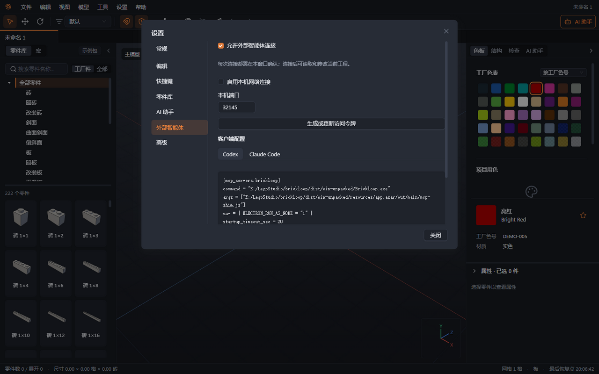
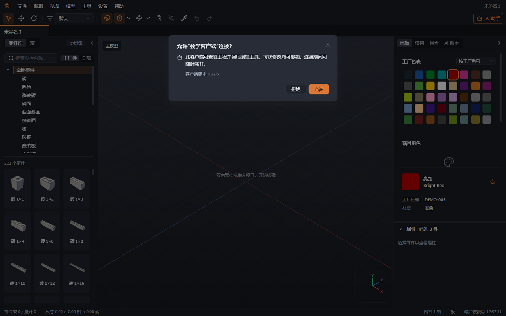

# 14 外部智能体（MCP）

本章你将学会：让 Codex 或 Claude Code 连接正在运行的 Brickloop，确认连接范围，并在需要时断开。

MCP 是让智能体调用软件工具的连接协议。连接后，外部客户端可以查询工程、选择文档、搭建、改色、检查和导出。外部客户端使用它自己的模型账户与计费设置，Brickloop 不读取它的登录凭据。

## 开启连接并取得配置

1. 启动 Brickloop，打开准备操作的工程并保存一份当前版本。
2. 从“设置 → AI 设置”打开设置对话框，切换“外部智能体”页；此连接默认关闭。
3. 勾选“允许外部智能体连接”。普通本机连接使用 stdio，即客户端与本机连接程序之间的输入输出通道，不需要开启网络端口。
4. 在“客户端配置”中选择 Codex 或 Claude Code，复制当前机器生成的内容，合入客户端已有配置，保留原有其他设置。
5. 按客户端的方式重新加载 MCP 配置或重新启动会话，保持 Brickloop 正在运行。



## Codex 配置示例

以下是设置页为 Windows 安装版生成的 TOML 格式。示例安装位置 `E:/Apps/Brickloop` 是虚构路径，请用你自己的设置页内容替换整个路径。路径作为单独的参数传递，含空格时也不要额外嵌入一层引号；请连同环境变量设置一起复制。

```toml
[mcp_servers.brickloop]
command = "E:/Apps/Brickloop/Brickloop.exe"
args = ["E:/Apps/Brickloop/resources/app.asar/out/main/mcp-shim.js"]
env = { ELECTRON_RUN_AS_NODE = "1" }
startup_timeout_sec = 20
tool_timeout_sec = 90
# 用 codex exec 无人值守运行时，取消下一行注释，才能执行修改模型的工具
# default_tools_approval_mode = "approve"
```

1. 将这段配置合入 Codex 使用的 `config.toml`，已有同名 `brickloop` 项时更新该项，避免重复注册。
2. 重新加载客户端连接，让它先请求模型摘要。
3. 回到 Brickloop 处理连接确认，再进行编辑任务。

## Claude Code 配置示例

下面对应设置页的 JSON 格式。路径同样需要替换为设置页显示的实际路径。

```json
{
  "mcpServers": {
    "brickloop": {
      "type": "stdio",
      "command": "E:/Apps/Brickloop/Brickloop.exe",
      "args": ["E:/Apps/Brickloop/resources/app.asar/out/main/mcp-shim.js"],
      "env": { "ELECTRON_RUN_AS_NODE": "1" }
    }
  }
}
```

1. 将 `brickloop` 条目合入 Claude Code 项目的 `.mcp.json`，或在客户端的 MCP 配置入口填写相同内容。
2. 保留已有 `mcpServers` 中其他连接，重新加载配置。
3. 首次调用工具时回到 Brickloop 确认。

安装版随应用提供连接程序，不需要另外安装 Node。若使用开发版，设置页会生成 `command = "node"` 及 `.mjs` 脚本路径，使用该机器生成的配置即可，不要混用两种入口。

## 确认首次连接与操作范围

1. 外部客户端第一次实际调用工程工具时，Brickloop 弹出“允许‘客户端名’连接？”。仅在客户端中看到工具列表，不表示已经获得工程访问权限。
2. 核对客户端名称与版本是否对应刚才的操作，点击“允许”或“拒绝”。每条新连接都需要确认；关闭后重连也需再次确认。
3. 连接后查看状态栏“外部智能体”数量。先让客户端查询工程摘要，再说明要操作哪个文档、哪些零件和哪些限制。
4. 编辑完成后在 Brickloop 查看结果、运行检查并保存。每次修改工具调用形成一个撤销点；一个批量调用中的修改可以一起撤销。外部客户端的一轮对话可能包含多次调用，需要多次撤销。



“仅使用本机模型”约束的是 Brickloop 内置助手。外部客户端查询到的工程和图片可能被它发送给自己的模型服务商，数据去向与费用限制需要在外部客户端中设置；Brickloop 的 API 每日费用上限不控制外部账户。

## 可选本机网络连接

1. 只有客户端需要 HTTP 连接时，才准备本机网络连接；先保持“启用本机网络连接”关闭。
2. 设置“本机端口”，点击“生成或更新访问令牌”，使用“复制访问令牌”取得令牌。
3. 勾选“启用本机网络连接”，在客户端配置设置页显示的实际地址，例如 `http://127.0.0.1:<端口>/mcp`，并按客户端要求设置 Bearer 访问令牌。此地址仅供同一台电脑使用。
4. 令牌不要放入共享配置、截图或项目仓库。更新令牌后，同步更新客户端并重新连接；HTTP 连接仍需 Brickloop 弹窗确认。

## 断开与重新连接

1. 点击状态栏外部智能体区域的“断开”，结束已有连接。
2. 若不再允许新连接，在“外部智能体”页取消“允许外部智能体连接”，并按需关闭本机网络连接。
3. 已完成的修改仍保留；检查结果后决定保存或撤销。断开不等于回滚。
4. 再次使用时，从外部客户端重新启动 MCP 会话，再回到 Brickloop 确认。已断开的连接不会自行恢复授权。

## 使用搭建脚本

外部智能体可以调用 `list_build_examples`、`get_build_example` 和 `get_design_guide`，读取英文范例和分类指南，再用 `run_build_script` 生成大面积或重复结构。单个零件的小调整仍使用原有逐件工具。

运行参数包括稳定的 `scriptId`、名称、JavaScript 全文或统一 diff 补丁、目标子模型名（`root` 表示根模型）、`replace` 或 `add` 模式、`factory` 或 `all` 零件范围，以及随机种子。已有脚本可省略代码直接重新运行；新脚本需要代码。`replace` 只删除该脚本仍带来源标记的旧输出，`add` 保留并继续跟踪已有输出。相同代码、目录、范围和种子的输出哈希相同。

`get_build_script` 和 `list_build_scripts` 可读取工程内的代码及运行记录。每次运行后应检查返回的统计、连通性和薄弱连接警告、子模型包围盒，再用 `render_views` 或 `view_layers` 检查结果。`view_layers` 按板高返回俯视文字图，适合低成本检查布局；倾斜零件及未知尺寸会注明跳过，精确外形仍以渲染图为准。脚本错误包含错误码和源码行、列位置。

MCP 脚本直接写入当前文档，每次工具调用形成一个撤销点，不进入内置 AI 的工作副本审阅，也不受“只改选中部分”约束。脚本随 `.brkl` 工程保存；导出 `.io` 不含脚本。结构面板中可以查看、重新运行或解除输出的脚本来源。

下一章：[快捷键](15-快捷键.md)。
