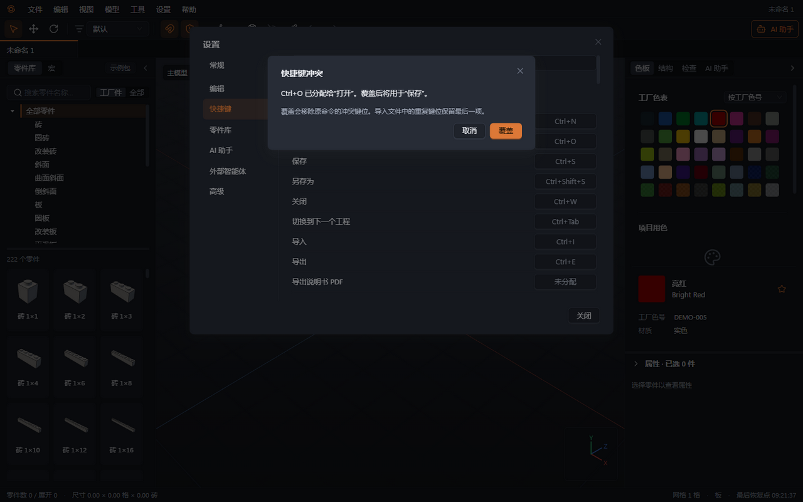

# 15 快捷键

本章你将学会：按操作类别查询 Windows 默认快捷键，分清视口与输入框中的按键，并保存个人键位配置。

下表按当前默认按键处理与界面名称整理。快捷键可在设置中修改，修改后以菜单和工具提示显示的组合键为准。执行视口操作前，先让输入框结束文字编辑；在名称、数值或 AI 消息框里输入 W、A、S、D 等字母时，不会用它们移动零件。

## 文件与文档

| 命令             | 默认快捷键   | 说明                           |
| ---------------- | ------------ | ------------------------------ |
| 新建             | Ctrl+N       | 新建工程标签                   |
| 打开             | Ctrl+O       | 打开工程或支持的模型文件       |
| 保存             | Ctrl+S       | 保存当前工程                   |
| 另存为           | Ctrl+Shift+S | 保存到新位置或新名称           |
| 关闭             | Ctrl+W       | 关闭当前文档，有修改时提示保存 |
| 切换到下一个文档 | Ctrl+Tab     | 在已打开的标签之间切换         |
| 导入             | Ctrl+I       | 打开模型导入入口               |
| 导出             | Ctrl+E       | 打开导出入口，默认 Studio .io  |

## 编辑与选择

| 命令               | 默认快捷键             | 说明                                                                           |
| ------------------ | ---------------------- | ------------------------------------------------------------------------------ |
| 撤销               | Ctrl+Z                 | 撤销当前文档的上一次修改                                                       |
| 重做               | Ctrl+Shift+Z 或 Ctrl+Y | 重做已经撤销的修改                                                             |
| 复制               | Ctrl+C                 | 复制所选内容                                                                   |
| 剪切               | Ctrl+X                 | 剪切所选内容                                                                   |
| 粘贴               | Ctrl+V                 | 粘贴并进入放置预览                                                             |
| 复制并附在鼠标上   | C                      | 复制后直接预览放置                                                             |
| 删除               | Delete                 | 删除所选内容                                                                   |
| 全选               | Ctrl+A                 | 选当前编辑范围内的可见内容                                                     |
| 取消／退出当前操作 | Esc                    | 优先取消预览、拖动、菜单或吸管；没有这些操作时退出编辑层级，在主模型中取消选择 |
| 吸管               | I                      | 切换吸管，点选已有零件取色                                                     |

“选择同色零件”“选择同类型零件”“选择同色同类型零件”“选择已连接零件”“反选”没有默认组合键，可从“编辑”菜单或选择模式使用。

## 移动、旋转与网格

| 操作               | 默认快捷键   | 方向或步长                               |
| ------------------ | ------------ | ---------------------------------------- |
| 水平向前／向后移动 | W / S        | 沿当前视角最近的水平轴，每次一个水平步长 |
| 水平向左／向右移动 | A / D        | 沿当前视角对应的左右轴                   |
| 向上／向下移动     | Q / E        | 每次一个竖直步长                         |
| 绕竖直轴旋转       | ← / →        | 采用当前旋转步长，默认 90°               |
| 绕视角水平轴旋转   | ↑ / ↓        | 采用当前旋转步长，默认 90°               |
| 小步旋转           | Shift+方向键 | 普通选择或放置预览每次 45°               |
| 水平网格 1 格      | 数字行 1     | 20 LDU                                   |
| 水平网格 ½ 格      | 数字行 2     | 10 LDU                                   |
| 水平网格 ¼ 格      | 数字行 3     | 5 LDU                                    |
| 对齐网格           | Ctrl+Shift+A | 将所选内容对齐当前网格                   |

普通方向键和旋转手柄使用当前“旋转步长”；Shift+方向键固定为 45°，自由模式下普通方向键为 5°。以连接点为中心调整关节时，方向键还会采用连接约束及限位，不应把普通旋转表当作所有关节的固定步长。

## 视图与可见性

| 命令           | 默认快捷键               |
| -------------- | ------------------------ |
| 隐藏所选       | H                        |
| 只显示所选     | Shift+H                  |
| 显示全部       | Alt+H                    |
| 适配全部       | Ctrl+0（数字行）         |
| 适配所选       | F                        |
| 前视图／后视图 | 小键盘 1 / Ctrl+小键盘 1 |
| 右视图／左视图 | 小键盘 3 / Ctrl+小键盘 3 |
| 顶视图／底视图 | 小键盘 7 / Ctrl+小键盘 7 |
| 逐步查看       | Ctrl+Shift+P             |

等轴测、透视／正交切换和导出截图没有默认组合键，可从“视图”菜单使用。数字行 1、3 与小键盘 1、3 功能不同；笔记本没有小键盘时使用菜单选择视角。

## 编组、子模型、检查与 AI

| 命令                      | 默认快捷键   | 说明                                                                         |
| ------------------------- | ------------ | ---------------------------------------------------------------------------- |
| 建组                      | Ctrl+G       | 对同一模型内的选择建组                                                       |
| 解散组                    | Ctrl+Shift+G | 移除编组关系，保留零件位置                                                   |
| 建子模型                  | Ctrl+Alt+G   | 将选择转为可复用部件                                                         |
| 重命名                    | F2           | 根据当前选择重命名组或子模型                                                 |
| 进入组或子模型            | 双击         | 进入内部编辑                                                                 |
| 退出组或子模型            | Esc          | 没有进行中的预览等操作时，返回上一级                                         |
| 运行检查                  | F7           | 打开检查区域                                                                 |
| 选中即提问 / 打开 AI 助手 | Ctrl+K       | 有选择且焦点在视口或编辑区时打开就地输入条；其他情况打开 AI 面板并聚焦输入框 |
| 发送 AI 消息              | Enter        | 在 AI 消息框内生效                                                           |
| AI 消息换行               | Shift+Enter  | 在 AI 消息框内生效                                                           |

输入 `@` 后，上下键选择引用，Enter 或 Tab 插入，Esc 关闭候选。输入法组合期间这些键交给输入法处理。就地输入条为单行，Enter 发送、Esc 关闭；候选打开时先完成候选操作。

“再放一个”“解除共享”“展开子模型”“将所选保存为宏”“插入宏”“添加步骤”“删除步骤”“移动步骤”“分配步骤”以及吸附、碰撞开关没有默认组合键，使用对应菜单或面板入口。

## 鼠标与放置组合

| 操作                     | 默认方式          |
| ------------------------ | ----------------- |
| 加选或移除一件           | Ctrl+单击         |
| 追加框选                 | Shift+拖动选择框  |
| 进入编组内部             | 双击，或 Alt+单击 |
| 旋转视角                 | Alt+左键拖动      |
| 平移视角                 | 中键或右键拖动    |
| 缩放视角                 | 滚轮              |
| 连续放置                 | Shift+单击        |
| 放置／拖动时临时关闭吸附 | 按住 Alt          |
| 线性连接连续滑动         | 按住 Shift        |

## 修改、恢复与导入导出键位

1. 选择“设置 → 设置 → 快捷键”（Ctrl+, 打开设置），按命令分组查找，也可搜索命令名称或组合键。
2. 点击该命令的键位，录入新的组合键。遇到冲突提示时，选择“覆盖”把该键位转给当前命令，或“取消”保留原配置。
3. 更改立即保存。查看菜单、工具提示和右键菜单，确认新键位同步显示，并在一个小模型中试用。
4. 需要回到统一操作习惯时，使用“恢复默认”。
5. 使用导出功能保存键位 JSON；在另一台机器导入时检查冲突和命令对应关系；含重复键位的文件会提示确认，选择覆盖后保留文件中最后一个命令的该键位，取消则不改变当前配置。未知命令、无效键位或不支持的文件版本会被拒绝。键位文件只用于操作配置，不是工程文件。

下一章：[常见问题](16-常见问题.md)。
