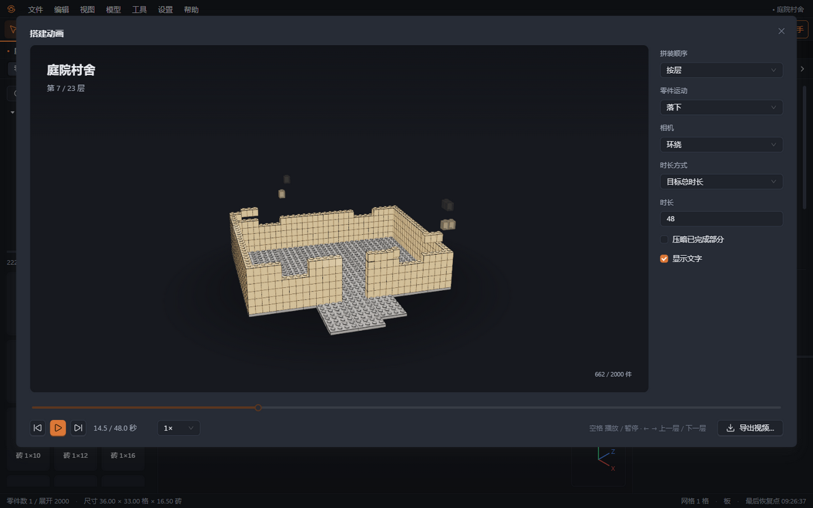
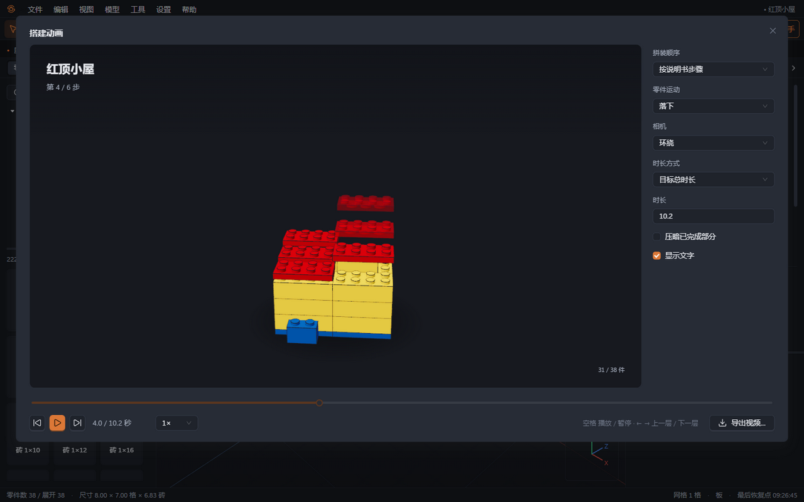
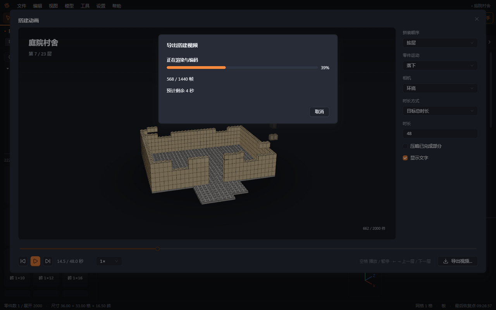

# 17 搭建动画

设计完成后，可以把成品从底部逐层拼起来，或按说明书步骤播放，再导出视频。动画只读取工程；关闭播放器后，编辑视角、选择、文档和撤销历史保持原样。

## 打开播放器

- 选择“视图 → 搭建动画…”，播放整个工程。
- 在结构面板右键单击子模型，选择“播放搭建动画”，只播放该子模型。
- 看图搭建完成后，点击报告卡片或合并审阅条上的“播放搭建动画”。
- 在说明书导出对话框点击“预览搭建动画”，默认按说明书步骤播放。

模型没有零件时，入口禁用，并显示原因。打开播放器后自动播放。

如果个别零件的几何无法读取，播放器会跳过它们，提示未显示的零件数量，其余部分仍可播放和导出。

## 调整画面与节奏

默认按零件底面高度分层。零件沿斜向扫掠依次落下，淡入后到位提亮；大模型会把同层相邻零件合成批次。相机按最终模型取景，播放期间不缩放，搭建时环绕 90°，片尾再环绕一圈。

播放器右侧可调整：

- **拼装顺序**：按层，或按说明书步骤。共享子模型先在首次放置的位置按步骤搭建，后续副本随父步骤出现。步骤不足 3 个或单步超过 80 件时，会建议改用按层。
- **零件运动**：落下、从模型外侧飞入、直接淡入。
- **相机**：环绕，或固定在打开播放器时的编辑视角。片尾仍会环绕展示完整模型。
- **时长**：目标总时长为 5–120 秒，包含 3 秒片尾；也可以设置每层或每步的固定时长，最低为 0.6 秒。按步骤播放时，每步至少保留 0.6 秒；步骤很多时，实际总时长可能超过设置的目标。
- **压暗已完成部分**与**显示文字**：文字包含工程名、当前层或步骤、零件计数；导出沿用文字设置。

切换压暗、文字或相机模式会保留当前播放位置。调整顺序、运动方式或时长会重新开始。环绕取景会为运动中的零件和标题留出空间；关闭文字后，画面使用更小的顶部留白。播放器与导出都使用完整的 16:9 画面。

底部可暂停、拖动进度、跳到上一层或下一层，或使用 0.5×、1×、2×、4× 播放。焦点在画面或播放按钮上时，空格切换播放，左右方向键切换层或步骤。速度倍率只影响实时预览；视频时长以时间轴设置为准。

## 导出视频

点击“导出视频…”，选择 720p、1080p 或 1440p，以及 30 或 60 帧/秒。默认是 1080p30 的 MP4（H.264），没有音轨。需要浅色汇报背景时勾选“白色背景”。

程序先检查系统编码支持。如果 H.264 不可用，会说明原因并改用 WebM（VP9），文件扩展名也会改为 `.webm`。需要在微信或 Windows 播放器中分享时，优先使用 MP4。

点击“导出视频”，在系统保存对话框选择位置。视频按固定帧率逐帧生成，分辨率不受播放器窗口大小影响。导出时显示进度和预计剩余时间，点击“取消”可停止。取消或写入失败不会留下不完整文件，也不会覆盖已有的完整视频。

